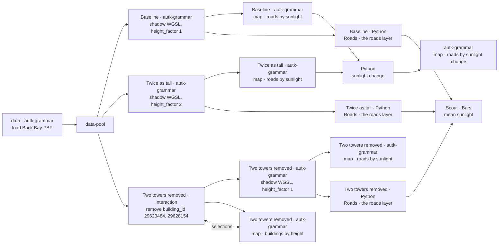

# Example: Back Bay road sunlight when buildings change

This example runs the per-road sunlight shader from [Example 7](07-autark-gpu-shader.md) in three
scenarios over Boston's Back Bay: **Baseline**, with every building at its own height,
**Twice as tall**, with every building's height doubled, and **Two towers removed**, with two
towers taken out: 200 Clarendon, the tallest, and Raffles. The height factor is a widget on the
shadow step, and the towers are removed by a Map Editor node. Each scenario ends in a Roads node
that takes its roads with their sunlight. Scout's Bars node charts each scenario's mean road
sunlight on the June solstice from them, and a Python node takes the sunlight each road loses when
the buildings get twice as tall, which an Autark map after it draws.

> [!NOTE]
> **WebGPU required**
> Autark relies on WebGPU. Run this example in a Chromium-based browser (Chrome / Edge) on a machine
> with a working GPU stack. `navigator.gpu` must be available.

## Pipeline overview



A single `data` node loads the PBF once, and a `data-pool` hands its layers to every scenario.
The loader and the pool are the scenarios' fixed context: they sit outside all three, and all three
read them. Each scenario's nodes are its levers: the shadow step, its map and its Roads node, and
in Two towers removed the Map Editor node before them and its map of the buildings. In Twice as
tall and in Two towers removed the shadow step, the map and the Roads node are copies of their
Baseline twins and name them, so the scenarios' levers are paired when they are compared.

## Data

`docs/examples/data/back_bay.osm.pbf` is an OpenStreetMap extract for Boston's Back Bay (© OpenStreetMap
contributors, ODbL 1.0), built by `scripts/build_example_pbfs.py`. The data node requests the layers the shader needs:
`surface`, `parks`, `water`, `roads`, and `buildings`. Anything missing from the PBF is skipped
quietly; everything present materialises in EPSG:3395 (metric), which is what the shadow math
expects. The downstream compute and map nodes reference these layers by name (`table_osm_roads`,
`table_osm_buildings`), the named-layer case of
[Referencing Upstream Data in Autark Nodes](../ARCHITECTURE.md#referencing-upstream-data-in-autark-nodes).

```json
"data": [{
  "type": "osm",
  "pbfFileUrl": "docs/examples/data/back_bay.osm.pbf",
  "queryArea": { "geocodeArea": "Boston", "areas": ["Back Bay"] },
  "outputTableName": "table_osm",
  "autoLoadLayers": {
    "layers": ["surface", "parks", "water", "roads", "buildings"]
  }
}]
```

## Scenarios

| Scenario | Colour | Its nodes | height_factor |
| --- | --- | --- | --- |
| Baseline | blue | Shadow study, Roads by sunlight, Roads | 1 |
| Twice as tall | orange | copies of the three, each naming its twin | 2 |
| Two towers removed | green | Interaction and Buildings by height, then copies of the three | 1 |

The **Scenario** catalog's **In project** tab (**Scenario** in the top bar) lists the three, and each
one's details list the data pool as the fixed context it reads. Collapse them there and press
**Run All**: each scenario is one box, the loader and the pool run once for all three, and each box
shows its outcomes, its maps and its Roads node, once they are done. Double-click a box to expand it
in place.

## Removing two towers

In Two towers removed, a Map Editor node sits between the pool and the shadow step. It edits
the `table_osm_buildings` layer, picked in its list of layers, and hands on the other four layers as
they came. It also feeds **Buildings by height**, a map of the buildings, and an interaction edge
links the two: a building picked on the map is picked in the node, and what the node picks lights
up on the map. Its list holds one edit, made by clicking the two towers on that map
(shift-click adds the second) and pressing **Remove**: 200 Clarendon (240.8 m) and Raffles (136 m),
matched on their `building_id`. Its code holds that list:

```python
# Map Editor writes this code from its edit list: each edit, in the
# order it was made, on the features whose key is one of its ids. It is
# written again when the list changes.
return curio_edit_features(input_0, [
    {"op": "remove", "ids": [29623484, 29628154]},
], key="building_id", layer="table_osm_buildings")
```

A building's parts share its `building_id`, so the edit removes every part of both towers: 200
Clarendon's four and Raffles' three.

## The shadow step and its widget

Both shadow steps hold the same spec. The shader iterates `batched` over every building (so the
building ring and height are packed as uniform arrays the WGSL can loop over once per dispatch),
and runs per road segment. The height factor reaches the shader as a uniform: the spec places the
node's `height_factor` widget as `[!! height_factor !!]`, which a run replaces with the widget's
value.

```json
"compute": [{
  "dataRef": "table_osm_roads",
  "attributes":       { "seg": "geometry.coordinates" },
  "attributeMatrices":{ "seg": { "rows": "auto", "cols": 2 } },
  "uniforms": {
    "bld_height": {
      "fromFeature": {
        "layer": "table_osm_buildings",
        "iterate": "batched",
        "path": "properties.height",
        "required": true
      }
    },
    "doy": 172,
    "height_factor": [!! height_factor !!]
  },
  "uniformMatrices": {
    "ring": {
      "fromFeature": {
        "layer": "table_osm_buildings",
        "iterate": "batched",
        "path": "geometry.coordinates.0"
      },
      "cols": 2
    }
  },
  "outputColumnName": "sunlight",
  "wglsFunction": [ "...solar-time + AABB shadow projection; see Example 7 for the full body..." ]
}]
```

The widget is a slider in each shadow step's **Widgets** tab: `height_factor`, labelled Height
factor, from 0.5 to 4 in steps of 0.5, default 1. Baseline keeps the default, and Twice as tall
sets it to 2. Inside the per-building shadow loop the factor scales each building's height:

```text
let height = height_factor * bld_height[bi];
```

For each road segment, for every daylight hour on the June solstice (`doy = 172`), the shader
projects every building's footprint AABB along the sun direction by `shadow_len = height / tan(alt)`
and checks whether the road segment intersects that shadow rectangle. If no building shades the
segment for that hour, the segment earns 60 minutes of sunlight. Boston coordinates: `lat_rad = 0.7393`
(≈ 42.36 °N), `lon_loc = -71.06`. A factor of 2 doubles `shadow_len`, so Twice as tall's shadows
reach twice as far down-sun.

## Render

Each scenario's map renders the full layer stack with roads as the colour-map / pick layer,
coloured by the shader's `sunlight` output column:

```json
"map": { "layerRefs": [
  { "dataRef": "table_osm_surface" },
  { "dataRef": "table_osm_parks" },
  { "dataRef": "table_osm_water" },
  { "dataRef": "table_osm_buildings" },
  { "dataRef": "table_osm_roads",
    "isPick": true, "isColorMap": true,
    "getFnv": "sunlight", "getFnvType": "quantitative", "defaultFnv": 0,
    "title": "Sunlight (minutes)" }
]}
```

## Comparing the scenarios

A shadow step hands on the layers it computed, all five of them. Each scenario's **Roads** node, a
Python node, reads its shadow step and takes the roads, each with its `sunlight`, through a layer
chip:

```python
# The shadow step hands on all five of its layers, the roads with each
# one's minutes of sunlight among them. This takes the roads, for the
# chart of the scenarios' mean sunlight.
return [!! input_0:table_osm_roads !!]
```

**Mean sunlight** is a **Bars** node of the Scout package (`curio.scout@1`). A chart reads one
table on each of its inputs, and its three take the three Roads nodes, in the order the dataflow
lists the scenarios. It reads their roads stacked as one table, `[!! inputs !!]`, each road under the
`scenario` and `scenario_name` of the box its input comes from, and draws a bar for each scenario's
mean `sunlight`, in the scenario's colour: rename or recolour a scenario, and the chart follows. Its
widgets set what it draws: **Y column** `sunlight`, **Combine** `mean`, and **Y axis title** `mean
of sunlight`. Twice as tall's bar is the lowest and Two towers removed's the highest.

**Sunlight change** is a Python node that takes Baseline's map on its first input and Twice as
tall's on its second. Each map hands on the five layers its shadow step computed, and the node
reads the roads of each through a layer chip:

```python
# Twice as tall's sunlight minus Baseline's, road by road, in minutes: what
# each road loses where the taller buildings' shadows reach it. Both read the
# same roads from the pool, so each road is matched by its shape, and a shape
# that repeats by its order.
import numpy as np

before = [!! input_0:table_osm_roads !!]
after = [!! input_1:table_osm_roads !!]


def shapes(roads):
    # Each road's shape, and how many roads before it have the same one.
    wkb = roads.geometry.to_wkb()
    return list(zip(wkb, wkb.groupby(wkb).cumcount()))


row_of = {shape: row for row, shape in enumerate(shapes(after))}
pairs = [(row, row_of[shape]) for row, shape in enumerate(shapes(before)) if shape in row_of]
roads = before.iloc[[row for row, _ in pairs]].reset_index(drop=True)
taller = after.iloc[[row for _, row in pairs]].reset_index(drop=True)
# The shadow step writes each road's sunlight twice, in a column and in the
# compute values it writes its outputs under, and both become the change.
roads["sunlight"] = taller["sunlight"].astype(float) - roads["sunlight"].astype(float)
roads["compute"] = [
    {**old, "sunlight": float(new["sunlight"]) - float(old["sunlight"])}
    for old, new in zip(roads["compute"], taller["compute"])
]
roads.insert(1, "change", np.where(roads["sunlight"] != 0, "changed", "unchanged"))
return roads
```

The node matches the roads by their shapes: both scenarios read the same roads from the pool.
Each road keeps its `osm_id` and holds Twice as tall's sunlight minus Baseline's, in `sunlight`
and in the `compute` values the shadow step writes, and `change` says whether it changed.

**Roads by sunlight change**, an Autark node after it, draws that difference: it colours each road
by its `sunlight` on a red, yellow and blue scale from -360 to 360 minutes. A road that loses
sunlight is red, deepest at six hours lost; a road with no change is pale yellow; and a road that
gains sunlight, which happens when Twice as tall's Height factor is set below 1, is blue.

```json
"map": { "layerRefs": [
  { "dataRef": "[!! input_0 !!]",
    "getFnv": "sunlight", "getFnvType": "quantitative",
    "colorMapInterpolator": "interpolateRdYlBu",
    "colorMapRange": [-360, 360],
    "title": "Sunlight change (minutes)" }
]}
```

## Final result

Three maps of Back Bay's road network, coloured by minutes of June-solstice sunlight, one per
scenario; a bar chart where Twice as tall has the lowest mean road sunlight and Two towers removed
the highest; and a map of the sunlight each road loses in Twice as tall, which is zero wherever no
taller building's shadow reaches it.
