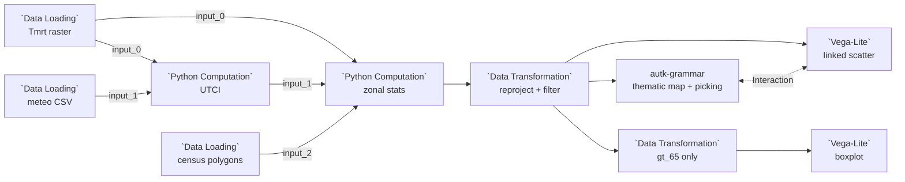

# Example: Heterogeneous data + cross-grammar linked views

This example combines three different data sources, a high-resolution thermal raster, a tabular meteorological feed, and a sociodemographic GeoDataFrame, into a single pipeline that derives the Universal Thermal Climate Index (UTCI) per Milan census tract, and then renders the result as an `autk-grammar` map and a Vega-Lite scatter linked by an interaction edge, beside a Vega-Lite boxplot. The use case is heat exposure of older adults in Milan; the framework story is that nodes with several inputs join heterogeneous data, and that two views link whichever grammar draws them.

> [!NOTE]
> **WebGPU required**
> The `autk-grammar` map step in this dataflow needs WebGPU. Run this example in a Chromium-based browser (Chrome / Edge) on a machine with a working GPU stack.

> [!NOTE]
> **Python dependencies**
> The code nodes import `rasterio`, `pythermalcomfort`, and `rasterstats`, which are provided by the `curio.weather` package, installed automatically when Curio starts with `--with-examples`, or on demand from the catalog drawer ("Weather Analysis"). Opening the seeded example project also triggers an automatic check that warns about and installs any of these that are missing in your own workspace.

## Pipeline overview



## Data

This example reads its inputs from the [Data Catalog](../DATA-CATALOG.md). Each loader node
addresses a dataset by id via `curio_data_path("<id>")`, so the dataflow runs unchanged from a checkout, a Docker deployment or a `pip` install.

| Dataset | Id | Format | Size |
|---|---|---|---|
| Milan Mean Radiant Temperature | `data.utk.milan-mrt` | geotiff | 1 band, 4632x4142 |
| Milan ERA5 Hourly Weather | `data.utk.milan-era5-weather` | csv | 24 rows |
| Milan Census Polygons (over 65) | `data.utk.milan-census-gt65` | geojson | 6,085 features |

All three ship in the committed catalog under `datasets/` and are already added to this dataflow.

### Provenance

The raster is the 2022 mean radiant temperature field for Milan (July 22, noon), pre-downsampled by a
factor of 4 per dimension and float16-quantized so the file fits in the repo; UTCI precision (about
0.06 °C in this range) is unaffected. The weather CSV is hourly ERA5 reanalysis (Td, Wind, RH) for the
same day, re-saved comma-delimited during the move into the catalog (the original export was
semicolon-delimited, which the catalog's generated loader cannot express). The census polygons are
trimmed to the `gt_65` (population over 65) column.

Original sources: Milan thermal raster from the [Curio team's bundled tutorial Drive](https://drive.google.com/drive/folders/1-cncKF-omB0av98WzKApKtyJTrgvfa0P?usp=sharing); census polygons from ISTAT.

## Step 1: Load the mean radiant temperature raster (`Data Loading`)

Read the GeoTIFF directly with `rasterio` and hand the dataset object downstream.

```python
import rasterio
src = curio_load_data("data.utk.milan-mrt")
return src
```

## Step 2: Load the meteorological CSV (`Data Loading`)

The hourly ERA5 file gives air temperature (Td), wind speed (Wind), and relative humidity (RH) per hour `it`. The downstream UTCI step picks the row matching the raster's noon timestamp.

```python
import pandas as pd
sensor = curio_load_data("data.utk.milan-era5-weather")
return sensor
```

## Step 3: Load census polygons (`Data Loading`)

A separate branch loads the sociodemographic GeoJSON that carries the `gt_65` column (the count of residents older than 65 per polygon).

```python
import geopandas as gpd
gdf = curio_load_data("data.utk.milan-census-gt65")
return gdf
```

## Step 4: Compute UTCI on the raster grid (`Python Computation`)

The raster goes into this node's first input circle and the meteo table into its second; the code reads them as `[!! input_0 !!]` and `[!! input_1 !!]` (see [Several inputs](../USAGE.md#several-inputs)). Read the noon weather row and call `pythermalcomfort.models.utci` to produce a UTCI value per pixel. Two non-obvious details in this node:

- `data.filled(np.nan)` collapses the rasterio MaskedArray to a plain float array with NaN for nodata, regardless of the raster's nodata sentinel.
- `limit_inputs=False` keeps UTCI valid when `tr − tdb > 30` (common at noon in Milan, where MRT is regularly 60 to 70 °C while air temperature stays around 30 °C). With the default `limit_inputs=True`, those pixels would silently come back as NaN and the map would render half-empty.

The output is the UTCI grid as a list-of-lists plus its `[width, height]` shape, packaged as a tuple so the downstream zonal-stats node can rebuild the array.

```python
# Step 4 - Compute UTCI

import numpy as np
from pythermalcomfort import models
from rasterio.warp import Resampling

src = [!! input_0 !!]
sensor = [!! input_1 !!]

timestamp = 12

# Bundled raster is already at the working resolution; no further downsample needed.
upscale_factor = 1.0
dataset = src
data = dataset.read(
    out_shape=(
        dataset.count,
        int(dataset.height * upscale_factor),
        int(dataset.width * upscale_factor),
    ),
    resampling=Resampling.nearest,
    masked=True,
)
data = data.astype(float).filled(np.nan)

sensor_filtered = sensor[sensor["it"] == timestamp]
tdb = float(sensor_filtered["Td"].values[0])
v = float(sensor_filtered["Wind"].values[0])
rh = float(sensor_filtered["RH"].values[0])

# `limit_inputs=False` keeps UTCI valid for tr - tdb > 30 (common at noon in Milan).
utci_result = models.utci(tdb=tdb, tr=data[0], v=v, rh=rh, units="SI", limit_inputs=False)
utci_grid = np.asarray(getattr(utci_result, "utci", utci_result), dtype=float)

if utci_grid.ndim == 3 and utci_grid.shape[0] == 1:
    utci_grid = utci_grid[0]
if utci_grid.ndim != 2:
    raise ValueError(f"UTCI must be 2D, got shape={utci_grid.shape}, ndim={utci_grid.ndim}")

utci_list = utci_grid.tolist()
utci_shape = [utci_grid.shape[1], utci_grid.shape[0]]

return (utci_list, utci_shape)
```

## Step 5: Spatially join UTCI into census polygons (`Python Computation`)

The node's three input circles take the original raster (for its CRS / transform), the UTCI tuple from Step 4, and the census polygons from Step 3, read as `[!! input_0 !!]`, `[!! input_1 !!]` and `[!! input_2 !!]`. Run `rasterstats.zonal_stats` to compute per-polygon UTCI statistics and attach the mean to each polygon.

```python
# Step 5 - Zonal Statistics

from rasterstats import zonal_stats
import numpy as np

dataset = [!! input_0 !!]
utci_list = [!! input_1 !!][0]
utci_shape = [!! input_1 !!][1]
gdf = [!! input_2 !!]

utci = np.asarray(utci_list, dtype=float)
shape = utci_shape

if utci.ndim != 2:
    raise ValueError(f"Expected 2D UTCI array, got shape={utci.shape}, ndim={utci.ndim}")

transform = dataset.transform * dataset.transform.scale(
    (dataset.width / shape[0]),
    (dataset.height / shape[1]),
)

# Avoid nodata warning and make nodata explicit
nodata_value = -999.0
utci_for_stats = np.where(np.isnan(utci), nodata_value, utci)

joined = zonal_stats(
    gdf,
    utci_for_stats,
    stats=["min", "max", "mean", "median"],
    affine=transform,
    nodata=nodata_value,
)

gdf["mean"] = [d["mean"] for d in joined]
result = gdf.loc[:, [gdf.geometry.name, "mean", "gt_65"]]


return result
```

## Step 6: Reproject and filter (`Data Transformation`)

Drop polygons with non-positive UTCI and reproject to EPSG:3395 so the `autk-grammar` map downstream sees the CRS its tile pipeline expects. The `metadata.name` keeps the table referenceable as `census` throughout the rest of the dataflow.

Note the assignment goes through ``__dict__['metadata']`` instead of plain attribute syntax: pandas emits a `UserWarning` when setting an unknown attribute on a sliced DataFrame, and curio's sandbox treats any non-empty stderr as a node failure during e2e. Curio reads `.metadata` back through `getattr`, so both write paths work, but only the dict path stays warning-free.

```python
import geopandas as gpd

gdf = input_0
filtered_gdf = gdf.set_crs(32632)
filtered_gdf = filtered_gdf.to_crs(3395)
filtered_gdf = filtered_gdf[filtered_gdf['mean'] > 0]
filtered_gdf.__dict__['metadata'] = {'name': 'census'}
return filtered_gdf
```

## Step 7: Thematic map of UTCI (`autk-grammar`)

The map is an `autk-grammar` node with just a `map` block. The census polygons are the node's first
input, the table `input_0`, written with the input chip `[!! input_0 !!]`;
the layer is coloured by the UTCI `mean` column and picking is enabled so the linked scatterplot can
highlight selected tracts. No JavaScript and no explicit data block, so the grammar reads the upstream
GeoDataFrame directly. This is the single-frame case of Autark's two upstream-referencing mechanisms; see
[Referencing Upstream Data in Autark Nodes](../ARCHITECTURE.md#referencing-upstream-data-in-autark-nodes).

```json
{
  "map": {
    "layerRefs": [
      { "dataRef": "[!! input_0 !!]", "getFnv": "mean", "getFnvType": "quantitative", "defaultFnv": 0, "isPick": true,
        "title": "Mean UTCI (°C)" }
    ]
  }
}
```

`getFnv: "mean"` resolves to `properties.mean` (the per-tract UTCI). A double-click picks a tract
(`isPick`), and the scatter marks its point.

## Step 8: Linked scatterplot of UTCI vs. older adults (`Vega-Lite`)

A Vega-Lite scatter of `gt_65` vs `mean` UTCI. Its interval selection colors the points it selects red, and with the interaction edge of Step 10 the map highlights the matching tracts. A tract picked on the map marks its point in the column `interacted`, which turns it red too.

```json
{
  "$schema": "https://vega.github.io/schema/vega-lite/v6.json",
  "params": [{"name": "clickSelect", "select": "interval"}],
  "mark": {"type": "point", "cursor": "pointer"},
  "encoding": {
    "x": {"field": "gt_65", "type": "quantitative"},
    "y": {"field": "mean",  "type": "quantitative", "scale": {"domain": [37, 42]}},
    "opacity": {"condition": {"param": "clickSelect", "value": 0.7}, "value": 0.3},
    "color": {
      "condition": [
        {"param": "clickSelect", "empty": false, "value": "red"},
        {"test": "datum.interacted === '1'", "value": "red"}
      ],
      "value": "blue"
    }
  }
}
```

## Step 9: Boxplot of older-adult population (`Vega-Lite`)

Add a `Data Transformation` node that drops everything but `gt_65`, then a Vega-Lite boxplot reading from it. This view summarises the distribution of older-adult counts independent of UTCI.

```python
gdf = input_0
return gdf.loc[:, ["gt_65"]]
```

```json
{
  "$schema": "https://vega.github.io/schema/vega-lite/v6.json",
  "transform": [{"fold": ["gt_65"], "as": ["Variable", "Value"]}],
  "mark": {"type": "boxplot", "size": 60},
  "encoding": {
    "x": {"field": "Variable", "type": "nominal", "title": "Variable"},
    "y": {"field": "Value",    "type": "quantitative", "title": "Value"}
  }
}
```

## Step 10: Link the map and the scatter (interaction edge)

Connect the `autk-grammar` map and the `Vega-Lite` scatter with an edge of `type: "Interaction"`, between their top handles. A tract picked on the map marks the matching point of the scatter, and a brush on the scatter highlights the matching tracts on the map. The same edge links Vega-Lite and Autark views without either side knowing about the other.

## Final result

The map answers "where is heat exposure worst?", the scatter answers "is heat correlated with where older adults live?", and the boxplot anchors the older-adult distribution for context. A brush on the scatter or a pick on the map highlights the same tracts in the other view, whether Vega-Lite or Autark draws it.
