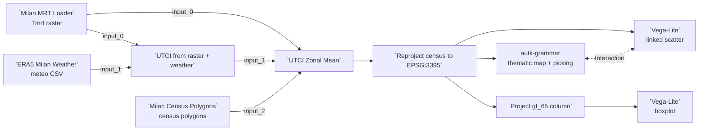

# Example: Heterogeneous data + cross-grammar linked views

This example combines three different data sources, a high-resolution thermal raster, a tabular meteorological feed, and a sociodemographic GeoDataFrame, into a single pipeline that derives the Universal Thermal Climate Index (UTCI) per Milan census tract, and then renders the result as an `autk-grammar` map and a Vega-Lite scatter linked by an interaction edge, beside a Vega-Lite boxplot. Every step before the views is a node of the Weather Analysis package, `curio.weather`. The use case is heat exposure of older adults in Milan; the framework story is that nodes with several inputs join heterogeneous data, and that two views link whichever grammar draws them.

> [!NOTE]
> **WebGPU required**
> The `autk-grammar` map step in this dataflow needs WebGPU. Run this example in a Chromium-based browser (Chrome / Edge) on a machine with a working GPU stack.

> [!NOTE]
> **Python dependencies**
> The Weather nodes' modules import `rasterio`, `pythermalcomfort`, and `rasterstats`, which the `curio.weather` package declares. Curio installs them when it starts with `--with-examples`, or when you add the package from the Node Catalog drawer ("Weather Analysis"). Opening the seeded example project also checks for any of them missing in your own workspace, and installs them.

## Pipeline overview



## Data

This example reads its inputs from the [Data Catalog](../DATA-CATALOG.md). Each loader node
reads its dataset by id with `curio_load_data("<id>")`, so the dataflow runs unchanged from a checkout, a Docker deployment or a `pip` install.

| Dataset | Id | Format | Size |
|---|---|---|---|
| Milan Mean Radiant Temperature | `data.utk.milan-mrt` | geotiff | 1 band, 4632x4142 |
| Milan ERA5 Hourly Weather | `data.utk.milan-era5-weather` | csv | 24 rows |
| Milan Census Polygons (over 65) | `data.utk.milan-census-gt65` | geojson | 6,085 features |

All three ship in the committed catalog under `datasets/` and are already added to this dataflow.

### Provenance

The raster is the 2022 mean radiant temperature field for Milan (July 22, noon), pre-downsampled by a
factor of 4 per dimension and float16-quantized so the file fits in the repo; UTCI precision (about
0.06 °C in this range) is unaffected. The weather CSV is hourly ERA5 reanalysis (Td, Wind, RH) for the
same day, saved comma-delimited. The census polygons are trimmed to the `gt_65` (population over 65)
column.

Original sources: Milan thermal raster from the [Curio team's bundled tutorial Drive](https://drive.google.com/drive/folders/1-cncKF-omB0av98WzKApKtyJTrgvfa0P?usp=sharing); census polygons from ISTAT.

## The Weather nodes

The dataflow names the `curio.weather` package, so its nodes are in the Node Catalog drawer and in the left Tools panel. Each loader's code is one read of the Data Catalog. Each computing node's code is a call of one function of the package's modules, which the header above the code lists under **Functions**, and its Widgets tab holds its settings. The [package's README](../../packages/curio.weather@1/README.md) lists the functions and the widgets.

## Step 1: Load the mean radiant temperature raster (`Milan MRT Loader`)

The loader hands the GeoTIFF downstream as an open `rasterio` dataset.

```python
return curio_load_data("data.utk.milan-mrt")
```

## Step 2: Load the meteorological CSV (`ERA5 Milan Weather`)

The hourly ERA5 file gives air temperature (Td), wind speed (Wind), and relative humidity (RH) per hour `it`. The UTCI step reads the row of the hour its **Hour** widget names.

```python
return curio_load_data("data.utk.milan-era5-weather")
```

## Step 3: Load census polygons (`Milan Census Polygons`)

A separate branch loads the sociodemographic GeoJSON that carries the `gt_65` column (the count of residents older than 65 per polygon), as a GeoDataFrame.

```python
return curio_load_data("data.utk.milan-census-gt65")
```

## Step 4: Compute UTCI on the raster grid (`UTCI from raster + weather`)

The raster goes into this node's first input circle and the meteo table into its second; the code reads them as `[!! input_0 !!]` and `[!! input_1 !!]` (see [Several inputs](../USAGE.md#several-inputs)). Its Widgets tab sets **Hour**, here 12, noon, the hour of the weather table it reads, and **Upscale factor**, here 1, so the raster is read at its own size. Its code calls `utci_grid`, the function of the package's module `weather_utci`, which computes `pythermalcomfort.models.utci` for each pixel:

- a pixel where the raster has no value is NaN in the grid, whatever the raster's nodata value is;
- `limit_inputs=False` keeps UTCI valid when `tr - tdb > 30`, which is common at noon in Milan, where MRT is regularly 60 to 70 °C while air temperature stays around 30 °C. With the default `limit_inputs=True`, those pixels would come back as NaN and the map would render half-empty.

The output is the UTCI grid as a list of rows plus its `[width, height]` shape, as a tuple, so the zonal mean can place the grid on the raster.

```python
from weather_utci import utci_grid

return utci_grid(
    [!! input_0 !!], [!! input_1 !!],
    timestamp=int([!! timestamp !!]),
    upscale_factor=float([!! upscale_factor !!]),
)
```

## Step 5: Spatially join UTCI into census polygons (`UTCI Zonal Mean`)

The node's three input circles take the original raster (for its CRS / transform), the UTCI tuple from Step 4, and the census polygons from Step 3, read as `[!! input_0 !!]`, `[!! input_1 !!]` and `[!! input_2 !!]`. Its code calls `utci_zonal_mean`, of the module `weather_census`, which runs `rasterstats.zonal_stats` over the grid and gives each polygon its geometry, its `mean` UTCI and its `gt_65`. A pixel with no value counts toward no mean.

```python
from weather_census import utci_zonal_mean

return utci_zonal_mean([!! input_0 !!], [!! input_1 !!], [!! input_2 !!])
```

## Step 6: Reproject and filter (`Reproject census to EPSG:3395`)

The node's Widgets tab sets **Source CRS**, here 32632, the UTM zone the census polygons are in, and **Target CRS**, here 3395, the CRS the views draw them in. Its call, `reproject_census`, reprojects the polygons, drops those whose mean UTCI is not above 0, and names the table `census` for the rest of the dataflow.

```python
from weather_census import reproject_census

return reproject_census(
    input_0,
    source_crs=int([!! source_crs !!]),
    target_crs=int([!! target_crs !!]),
)
```

## Step 7: Thematic map of UTCI (`autk-grammar`)

The map is an `autk-grammar` node with just a `map` block. The census polygons are the node's first
input, the table `input_0`, written with the input chip `[!! input_0 !!]`;
the layer is coloured by the UTCI `mean` column and picking is enabled so the linked scatterplot can
highlight selected tracts. No JavaScript and no explicit data block, so the grammar reads the upstream
GeoDataFrame directly. This is the single-frame case of Autark's two upstream-referencing mechanisms; see
[Referencing Upstream Data in Autark Nodes](../ARCHITECTURE.md#referencing-upstream-data-in-autark-nodes).

```json
{
  "map": {
    "layerRefs": [
      { "dataRef": "[!! input_0 !!]", "getFnv": "mean", "getFnvType": "quantitative", "defaultFnv": 0, "isPick": true,
        "title": "Mean UTCI (°C)" }
    ]
  }
}
```

`getFnv: "mean"` resolves to `properties.mean` (the per-tract UTCI). A double-click picks a tract
(`isPick`), and the scatter marks its point.

## Step 8: Linked scatterplot of UTCI vs. older adults (`Vega-Lite`)

A Vega-Lite scatter of `gt_65` vs `mean` UTCI. Its interval selection colors the points it selects red, and with the interaction edge of Step 10 the map highlights the matching tracts. A tract picked on the map marks its point in the column `interacted`, which turns it red too.

```json
{
  "$schema": "https://vega.github.io/schema/vega-lite/v6.json",
  "params": [{"name": "clickSelect", "select": "interval"}],
  "mark": {"type": "point", "cursor": "pointer"},
  "encoding": {
    "x": {"field": "gt_65", "type": "quantitative"},
    "y": {"field": "mean",  "type": "quantitative", "scale": {"domain": [37, 42]}},
    "opacity": {"condition": {"param": "clickSelect", "value": 0.7}, "value": 0.3},
    "color": {
      "condition": [
        {"param": "clickSelect", "empty": false, "value": "red"},
        {"test": "datum.interacted === '1'", "value": "red"}
      ],
      "value": "blue"
    }
  }
}
```

## Step 9: Boxplot of older-adult population (`Project gt_65 column`, `Vega-Lite`)

The **Project gt_65 column** node keeps only `gt_65`, with `gt65_column`, and a Vega-Lite boxplot reads from it. This view summarises the distribution of older-adult counts independent of UTCI.

```python
from weather_census import gt65_column

return gt65_column(input_0)
```

```json
{
  "$schema": "https://vega.github.io/schema/vega-lite/v6.json",
  "transform": [{"fold": ["gt_65"], "as": ["Variable", "Value"]}],
  "mark": {"type": "boxplot", "size": 60},
  "encoding": {
    "x": {"field": "Variable", "type": "nominal", "title": "Variable"},
    "y": {"field": "Value",    "type": "quantitative", "title": "Value"}
  }
}
```

## Step 10: Link the map and the scatter (interaction edge)

Connect the `autk-grammar` map and the `Vega-Lite` scatter with an edge of `type: "Interaction"`, between their top handles. A tract picked on the map marks the matching point of the scatter, and a brush on the scatter highlights the matching tracts on the map. The same edge links Vega-Lite and Autark views without either side knowing about the other.

## Final result

The map answers "where is heat exposure worst?", the scatter answers "is heat correlated with where older adults live?", and the boxplot anchors the older-adult distribution for context. A brush on the scatter or a pick on the map highlights the same tracts in the other view, whether Vega-Lite or Autark draws it.
