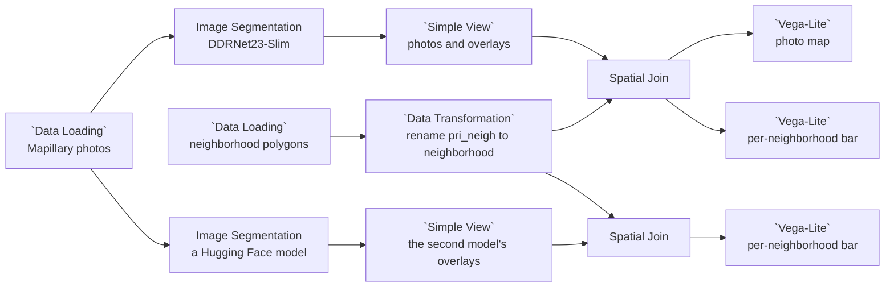

# Example: Street-level computer vision

This example labels every pixel of 40 Mapillary street photos taken around Lincoln Park in Chicago, pairs each photo with the neighborhood it was taken in, and draws what dominates each neighborhood's streets as a map of the photos and a bar chart. The use case is *urban greenery audits*, showing which streets are leafy and which are paved, but the same pipeline works for any class a segmentation model labels: sidewalks, traffic signs, building facades, and so on.

It runs two routes over the same photos. Route 1 uses **DDRNet23-Slim**, the model that ships with Curio, and needs no network. Route 2 uses a model you add from Hugging Face.

> [!NOTE]
> **Setup required**
> The example declares DDRNet23-Slim's model package, which Curio installs when you open it; the package brings `onnxruntime` and the **Image Segmentation** node. The photos and DDRNet23-Slim ship with Curio, so route 1 runs as it opens. Route 2 needs a model from the Discovery Catalog: see [Step 6](#step-6-a-second-model-from-hugging-face).

## Pipeline overview



## Origin

Originally contributed by [@ManeeshJupalle](https://github.com/ManeeshJupalle) in [PR #120](https://github.com/urban-toolkit/curio/pull/120) as a CS 524 university project, which audited greenery in the same Lincoln Park box, `[-87.66, 41.91, -87.62, 41.94]`.

## Step 1: Load the photos (`Data Loading`)

The Data Catalog ships 40 Mapillary panoramas from that box as `data.curio.mapillary-sample`, each with its photographer (`creator`), capture time, heading and place. Mapillary photos are licensed CC BY-SA 4.0, so a figure made from them credits each photo's `creator`.

```python
photos = curio_load_collection("data.curio.mapillary-sample")

return photos
```

`curio_load_collection` gives one row per photo, with a `path` the next node reads and a `thumbnail` that Simple View draws.

## Step 2: Label every pixel (`Image Segmentation`)

The node comes from DDRNet23-Slim's model package. Its code names a model in the Model Catalog and the classes to report:

```python
"""Label every pixel of each image with a Model Catalog model.

The input is a collection's rows, each with a ``path``, as a Data Loading
node gives them for street-level images from the Data or Discovery Catalog.
To use another model, drag it from the Model Catalog onto this node.

``classes`` are the model's labels to report; each becomes a
``<class>_pct`` column, its share of the image's pixels in percent. ``None``
reports every label.
``dominant_class`` and ``dominant_pct`` name the one of them covering most,
and ``overlay_url`` shows the image tinted by class.
"""

model = curio_load_model("model.curio.ddrnet23-slim")
classes = ["vegetation", "terrain", "sky", "road", "sidewalk", "building"]

return curio_segment(input_0, model, classes)
```

Each row comes back with the results first: `dominant_class` and `dominant_pct`, then `vegetation_pct`, `terrain_pct` and the other classes asked for, each as a share of all the photo's pixels, then `overlay_url` and `segment_error` (empty unless the photo could not be read). Every input column follows, so the photo keeps its place and its credit.

DDRNet23-Slim labels the 19 Cityscapes classes; the Model Catalog's page for it lists them. A class the model does not label stops the node with a message naming the ones it has.

## Step 3: Inspect results (`Simple View`)

Wire Image Segmentation → `Simple View`. It is a built-in node with no configuration: each photo is a card showing the photo beside its overlay, captioned with the dominant class and the first class shares.

`Simple View` picks the image columns itself. It looks for the familiar names first (`image_url`, `overlay_url`, `image_content`, `image`, `thumbnail`) and otherwise sniffs the values, so any frame with pictures in it displays without being told which column holds them. When a frame has more than one image column, an **Image column** selector appears; leave it on `all` to compare photo against overlay, or pin it to `overlay_url` to study the masks on their own.

Clicking a card selects its row in the views linked to the `Simple View` by an interaction edge. `Simple View` passes its input straight through, so the Spatial Join downstream receives the same frame Image Segmentation emitted.

## Step 4: Load and prepare neighborhood polygons (`Data Loading`, `Data Transformation`)

The Data Catalog ships Chicago's [Boundaries, Neighborhoods](https://data.cityofchicago.org/d/y6yq-dbs2) layer as `data.cityofchicago.neighborhoods` (98 polygons named in `pri_neigh`). Any FeatureCollection works as long as each Polygon feature carries a string property to use as the tag.

```python
import geopandas as gpd

# Chicago official neighborhoods boundary (98 polygons, `pri_neigh` names),
# vendored in the Data Catalog so this example runs offline. Any polygon
# FeatureCollection with a string name property works here.
gdf = curio_load_data("data.cityofchicago.neighborhoods")

# __dict__, not plain assignment: pandas warns about creating a column via
# a new attribute name, and that warning lands in this node's output with
# an absolute site-packages path. NOT gdf.attrs, and do not just delete the
# line: the sandbox reads this name (sandbox/util/parsers.py) and both of
# those drop it silently from the emitted FeatureCollection.
gdf.__dict__["metadata"] = {"name": "chicago_neighborhoods"}
return gdf
```

The Spatial Join adds every column of the neighborhoods to each photo it pairs with one. The Chicago neighborhoods file calls the name `pri_neigh`; this example renames it to `neighborhood` with a `Data Transformation` node, the column the charts read.

```python
# Each Spatial Join adds these polygons' columns to every photo it pairs
# with one, and the charts read `neighborhood`. Chicago's file calls it
# `pri_neigh`.
import geopandas as gpd

gdf = input_0.rename(columns={"pri_neigh": "neighborhood"})
# __dict__, not plain assignment: pandas warns about creating a column via
# a new attribute name, and that warning lands in this node's output with
# an absolute site-packages path. NOT gdf.attrs, and do not just delete the
# line: the sandbox reads this name (sandbox/util/parsers.py) and both of
# those drop it silently from the emitted FeatureCollection.
gdf.__dict__["metadata"] = {"name": "chicago_neighborhoods"}
return gdf
```

## Step 5: Pair each photo with its neighborhood and chart it (`Spatial Join`, `Vega-Lite`)

The Spatial Join node (built-in, in `curio.builtin@1`) has two input circles on its left edge, each a hollow ring that fills in once wired: **input_0** (the upper, blue one) and **input_1** (the lower, green one). Wire the `Simple View` output to the blue circle and the `Data Transformation` output to the green circle, and run them. The operation stays at **intersects** and the output at **One row per pair**, the defaults.

The node emits one row per photo and neighborhood that meet: the photo's own columns, with the neighborhood's columns (`neighborhood`, `sec_neigh`, `shape_area`, `shape_len`) added. A photo outside every neighborhood has no pair and is left out; every one of the 40 sample photos has one.

A `Vega-Lite` node wired to the join maps the photos, each colored by the dominant class of its neighborhood. The spec works out that class itself: it counts the photos of each class in each neighborhood, then gives every photo the class its neighborhood has most of, with that class's mean share:

```json
{
  "$schema": "https://vega.github.io/schema/vega-lite/v6.json",
  "width": 600,
  "height": 600,
  "projection": {"type": "mercator"},
  "layer": [
    {
      "transform": [
        {"filter": "datum.geometry != null"},
        {
          "joinaggregate": [
            {"op": "count", "as": "class_count"},
            {"op": "mean", "field": "dominant_pct", "as": "class_pct"}
          ],
          "groupby": ["neighborhood", "dominant_class"]
        },
        {
          "window": [
            {"op": "first_value", "field": "dominant_class", "as": "neighborhood_dominant_class"},
            {"op": "first_value", "field": "class_pct", "as": "neighborhood_dominant_pct"}
          ],
          "sort": [{"field": "class_count", "order": "descending"}],
          "groupby": ["neighborhood"],
          "frame": [null, null]
        }
      ],
      "mark": {"type": "geoshape", "stroke": "#888", "strokeWidth": 0.4},
      "encoding": {
        "color": {
          "field": "neighborhood_dominant_class",
          "type": "nominal",
          "scale": {
            "domain": ["road","sidewalk","building","vegetation","sky","terrain"],
            "range":  ["#4A90D9","#8B5CF6","#2ECC71","#F5A623","#3498DB","#2C3E50"]
          },
          "legend": {"title": "Dominant class"}
        },
        "tooltip": [
          {"field": "neighborhood", "title": "neighborhood"},
          {"field": "neighborhood_dominant_class", "title": "dominant"},
          {"field": "neighborhood_dominant_pct", "title": "avg %", "format": ".2f"}
        ]
      }
    }
  ]
}
```

A second `Vega-Lite` off the same join counts photos per neighborhood, each bar split by dominant class:

```json
{
  "$schema": "https://vega.github.io/schema/vega-lite/v6.json",
  "width": 400,
  "height": {"step": 16},
  "transform": [
    {"filter": "datum.neighborhood != null"},
    {
      "aggregate": [{"op": "count", "as": "image_count"}],
      "groupby": ["neighborhood", "dominant_class"]
    }
  ],
  "mark": "bar",
  "encoding": {
    "y": {"field": "neighborhood", "type": "nominal", "sort": "-x", "title": null},
    "x": {"field": "image_count", "type": "quantitative", "title": "images"},
    "color": {
      "field": "dominant_class",
      "type": "nominal",
      "scale": {
        "domain": ["road","sidewalk","building","vegetation","sky","terrain"],
        "range":  ["#4A90D9","#8B5CF6","#2ECC71","#F5A623","#3498DB","#2C3E50"]
      }
    }
  }
}
```

## Step 6: A second model from Hugging Face

The second Image Segmentation node runs on the same photos and reports every class its model names:

```python
"""The same photos, with a model from Hugging Face.

Add one in the Discovery Catalog (Hugging Face models, for example
openmmlab/upernet-convnext-tiny), then drag it from the Model Catalog onto
this node. Until then it runs DDRNet23-Slim, the model that ships with Curio.
"""

model = curio_load_model("model.curio.ddrnet23-slim")
classes = None  # every class the model names

return curio_segment(input_0, model, classes)
```

To give it a model of its own:

1. Open the **Discovery Catalog** and choose **Hugging Face models**. It lists image segmentation models Curio can run.
2. Find a model, for example `openmmlab/upernet-convnext-tiny` (ADE20K's 150 classes, MIT license), and click **Add to Model Catalog**. Curio downloads it, and installs the libraries its runtime needs: `onnxruntime`, or `torch` and `transformers`.
3. Back on the canvas, click **Model Catalog** in the top bar and drag the model's card onto this node. Its `curio_load_model(...)` line now names the new model.
4. Run the node. The `Simple View`, Spatial Join and bar chart after it show the new model's classes.

The bar chart for this route names no colours, so it draws whatever classes the model reports. A model trained on other scenes labels other things: ADE20K says `tree` and `grass` where Cityscapes says `vegetation`.

## Use your own area

The sample is a fixed set of photos. To take photos of another place from Mapillary:

1. Get a Mapillary access token: sign in at [mapillary.com/dashboard/developers](https://www.mapillary.com/dashboard/developers), register an application, and copy its **Client Token** (it starts with `MLY|`).
2. Open **API Settings** from the top bar (on the canvas it opens on the right).
3. On the **API keys** tab, click **Add configuration**.
4. In **Kind**, choose **Mapillary access token**.
5. Paste the token and click **Save**.
6. The key's row shows **saved** in the list, and the Mapillary card in the Discovery Catalog reads **Token set**.
7. Open the **Discovery Catalog**, choose **Mapillary**, and click **Download** on **Street-level images**.
8. Set the **Area**: a place, coordinates or a dataset's extent give the box to take photos from, of at most 25 km². Choose how many photos with **Most images**, and how large with **Size**. Photos are taken from across the box, newest first.
9. Click **Download**. The photos land in the Data Catalog as a collection of their own, each with its creator.
10. In the example's first node, replace `data.curio.mapillary-sample` with the new collection's id (drag the collection from the Data Catalog onto the node to do it), and run the dataflow.

For another city, swap the neighborhood polygons in Step 4 for that city's, and rename its name column to `neighborhood` in the `Data Transformation`: NYC's boroughs file calls it `BoroName`.

## Expected output

On the sample, route 1 finds road the dominant class in the most photos, then sky, building and vegetation. Vegetation covers about 15% of a photo's pixels on average and up to about 35%, most in Sheffield & DePaul. Most photos fall in Lincoln Park (27), the rest in Sheffield & DePaul, Lake View and Old Town, so the bar chart has four bars with Lincoln Park's the longest.

## Limitations

- **Models run on the CPU.** DDRNet23-Slim takes a fraction of a second per photo; a large Hugging Face model can take several seconds.
