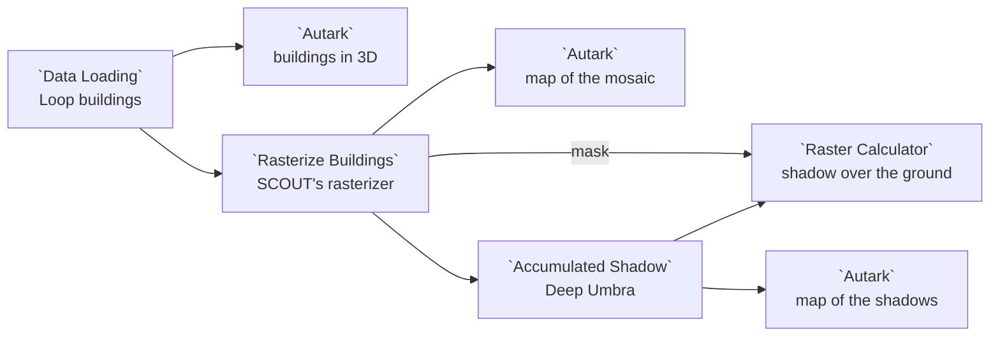

# Example: SCOUT building rasters

SCOUT's Deep Umbra shadow model does not read buildings: it reads map tiles in
which each pixel's gray level is the height of the building under it. This
example takes the buildings of SCOUT's own shadow example in the Chicago Loop,
draws them in 3D, and turns them into those tiles with the **Rasterize
Buildings** node of the `scout.raster-conversion@1` package, SCOUT's own
rasterizer ported to Curio. It draws the tiles joined into one map. Then the
**Accumulated Shadow** node of Deep Umbra's model package,
`model.scout.deep-umbra@1`, runs Deep Umbra on those heights: a map shows how
many minutes of a summer day each spot is in shadow, and a **Raster
Calculator** takes their statistics, the mean and median over the ground among
them, SCOUT's own two numbers.

## Pipeline overview



## Data

**SCOUT Chicago Loop Buildings** (`data.scout.loop-buildings`) holds the 123
buildings of SCOUT's high-rise shadow example, a few blocks of the central
Loop, with a height in metres for each: SCOUT's own buildings file, used with
the permission of SCOUT's authors.

The packages' libraries (`datashader`, `spatialpandas`, `dask`, `rasterio`,
`geopandas`, `numpy`, `pandas`, `pillow`, `pyarrow`, `pyproj`, `shapely`, and
`onnxruntime` for Deep Umbra) are installed with them. Curio installs both
packages for you when it starts with `--with-examples`, because this dataflow
declares them. Deep Umbra's package, which holds its weights, is in the
[Model Catalog](../MODEL-CATALOG.md).

## Load the buildings

```python
# SCOUT's Chicago Loop buildings, with their heights in metres.
gdf = curio_load_data("data.scout.loop-buildings")

# Mark the frame as buildings, so an Autark map extrudes each footprint
# to its height.
gdf.metadata = {"layerType": "buildings"}
return gdf
```

The `layerType` in the frame's metadata tells an Autark map these are
buildings, so it raises each footprint to its `height`:

```json
{
  "map": {
    "layerRefs": [
      {
        "dataRef": "[!! input_0 !!]",
        "getFnv": "height",
        "getFnvType": "quantitative",
        "colorMapInterpolator": "interpolateViridis",
        "title": "Building height (m)"
      }
    ]
  }
}
```

`title` names the layer in the legend, which would otherwise read `input_0`,
the table the input became.

## Rasterize them

Rasterize Buildings is a package node: its code calls the converter module the
package ships beside it, and its **Widgets** tab holds the three settings.

```python
"""Rasterize Buildings: SCOUT's building rasterizer, "OSM vector to raster".

Input: a buildings layer, a GeoDataFrame of polygons with a CRS and a column
of heights in metres.
Output: one raster in EPSG:3395, each cell a height in metres: the 256 by 256
map tiles SCOUT draws, 8-bit gray where 255 is the maximum height, side by
side. A tile SCOUT writes no file for, because no building is near it, is no
data. An Autark map draws it as input_0, band band_1, and SCOUT's Deep Umbra
shadow model (Accumulated Shadow) reads it.
The Widgets tab sets the height column, the zoom level and the maximum height.
Ported from SCOUT, https://github.com/urban-toolkit/scout.
"""
from scout_raster_conversion.node_outputs import rasterize_buildings

return rasterize_buildings(
    input_0,
    attribute=[!! attribute !!],
    zoom=int([!! zoom !!]),
    max_height=float([!! max_height !!]),
    output_file=curio_output_file,
)
```

| Widget | Default | What it sets |
|---|---|---|
| Height column | `height` | The column the heights are read from |
| Zoom level | `16` | The zoom level of the tiles; Deep Umbra reads zoom 16 |
| Maximum height | `550` m | The height drawn as gray level 255; Deep Umbra expects 550 |

The node returns one raster, a mosaic: every 256 by 256 tile placed side by
side in EPSG:3395, one band of heights in metres. Here that is 4 tiles, 2 by 2,
in 512 by 512 cells, the 4 height tiles SCOUT's example holds, each within one
gray level of SCOUT's own. SCOUT writes a tile only where a building is near
it; a tile it does not write would be no data in the mosaic.

## Draw the mosaic

An Autark map reads the node's raster as `input_0`, and colours each cell by
its band:

```json
{
  "map": {
    "layerRefs": [
      {
        "dataRef": "[!! input_0 !!]",
        "getFnv": "band_1",
        "colorMapInterpolator": "interpolateViridis",
        "isColorMap": false,
        "transferFunction": {
          "mode": "far-zero",
          "opacityMin": 0,
          "opacityMax": 1,
          "gamma": 0.0001
        }
      }
    ]
  }
}
```

A cell holds its building's height, rounded to SCOUT's steps of
550/255 = 2.16 m, drawn in viridis, from dark purple for the lowest buildings
to yellow for the tallest. The ground is a height of 0, a cell like any other.
The `transferFunction` leaves it clear: a cell's opacity
grows with its distance from 0 (`far-zero`), from none at the ground, and the
gamma of 0.0001 draws every building opaque. `"isColorMap": false` leaves the
map without a legend.

## Predict the shadows

Accumulated Shadow runs Deep Umbra on every tile of Rasterize Buildings' height
raster that holds heights. Its code imports the package's module, `deep_umbra`,
and names the model by its id:

```python
from deep_umbra import accumulated_shadow
model = curio_load_model("model.scout.deep-umbra")
return accumulated_shadow(input_0, season=[!! season !!], model=model, output_file=curio_output_file)
```

| Widget | Default | What it sets |
|---|---|---|
| Season | `summer` | `spring`, `summer` or `winter`, as SCOUT offers them |

For each tile, as SCOUT does, Deep Umbra reads a 512 by 512 window: the tile
and half of each neighbour, so a tower's shadow falls across the tile edge,
with planes for the tile's latitude and the season. It answers with the share
of the day each pixel is in shadow, which the node turns into minutes of a
720-minute summer day (540 in spring, 360 in winter). The output is one
raster on the height mosaic's grid: one band, the minutes of the day each cell
is in shadow.

## Sum it up over the ground

A Raster Calculator takes the statistics of the shadow on its input_0, with
Rasterize Buildings' heights on its input_1 as the mask: SCOUT's metrics count
the ground, the cells Deep Umbra reads as gray level 0, a height under 1.08 m.
No data, in either raster, is not counted.

```python
# Statistics: the mean, median, minimum, maximum and count of a
# raster's cells, nodata left out, as a table of one row.
# input_0 is the accumulated shadow in minutes, input_1 the heights it was
# predicted from, as the mask: SCOUT's metrics count the ground, the cells
# Deep Umbra reads as gray level 0, a height under 1.08 m.
return curio_raster_statistics(input_0, mask=input_1, where=lambda height: height < 1.08)
```

In summer the ground of these blocks is in shadow 128.6 minutes on average,
with a median of 3.3 minutes: SCOUT's own numbers for its example, within a
tenth of a minute. Many open cells see almost no shadow, while the canyons
between towers see hours of it.

## Draw the shadows

A third Autark map reads the shadow raster as `input_0`:

```json
{
  "map": {
    "layerRefs": [
      {
        "dataRef": "[!! input_0 !!]",
        "getFnv": "band_1",
        "colorMapInterpolator": "interpolateReds",
        "title": "Accumulated shadow (minutes)"
      }
    ]
  }
}
```

Every cell with a value is drawn opaque, from the palest red (the least
shadow) to the darkest (the most), as the legend shows. The darkest cells are
the street canyons between the towers the height mosaic shows.

## Good to know

- **Changing a widget re-runs the rasterizer.** A lower maximum height makes
  every tile brighter; Deep Umbra's own tiles keep 550 m, and Accumulated
  Shadow stops with a message saying so when the tiles were made otherwise.
- **Switch the season to compare.** Each season has its own sun and its own
  day, so the minutes change with both.
- **A tile at the edge sees no buildings beyond it.** Deep Umbra predicts each
  tile from it and its eight neighbours, as in SCOUT.
- **A tile with no data gets no shadow.** As in SCOUT, only the tiles the
  rasterizer wrote are predicted and counted; a tile with no data is ground to
  its neighbours.
- **Deep Umbra is an estimate.** It is a generative model trained on simulated
  shadows, so read the map as where shadow gathers, not as a survey.
- **Downloaded on a pip install.** A pip install downloads Deep Umbra from
  GitHub the first time Accumulated Shadow runs
  ([Installation from pip](../USAGE.md#installation-from-pip)).
