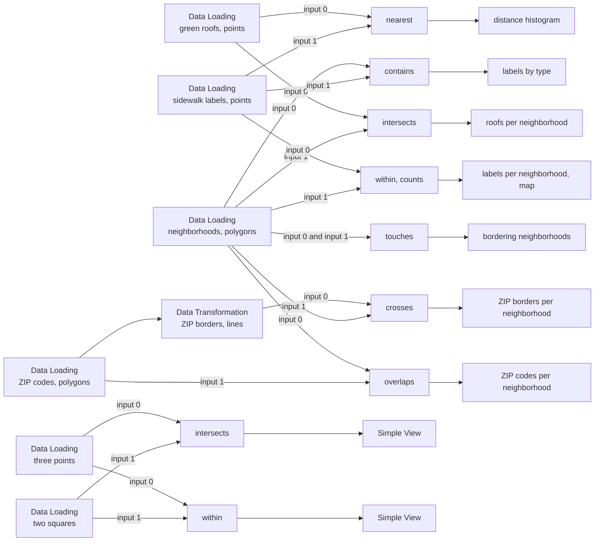

# Example: Spatial Join operations

This example runs every operation of the `Spatial Join` node, one flow each, over Chicago data. It covers points, lines and polygons on either input, both outputs, and the rule for a point that sits exactly on an edge.

## Pipeline overview



## Data

Loaded from the [Data Catalog](../DATA-CATALOG.md) by id.

| Dataset | Id | Shapes |
|---|---|---|
| Chicago Green Roofs | `data.cityofchicago.green-roofs` | 359 points |
| Project Sidewalk labels | `data.projectsidewalk.chicago-labels` | every 365th label: 400 points |
| Chicago neighborhoods | `data.cityofchicago.neighborhoods` | 98 polygons |
| Chicago Boundary (ZIP polygons) | `data.utk.chicago-boundary` | 61 polygons |

A `Data Transformation` turns each ZIP polygon into its border, a line:

```python
# Each ZIP's border as a line, for the crosses operation.
gdf = input_0[["zip", "geometry"]].copy()
gdf["geometry"] = gdf.boundary

return gdf
```

## How the node joins

The `Spatial Join` node has two input circles: **input 0** (the upper, blue one) and **input 1** (the lower, green one). Input 0 is the left side of the join, and either circle takes any shapes. The body reads as a sentence, *Pair each input 0 row with the input 1 rows it ...*, finished by the operation you pick.

Its output is either:
- **one row per pair**, input 0's row and shape with input 1's columns added. A column whose name input 0 already has comes in as `<column>_right`.
- **counts**: input 1's rows, each with `point_count`, the number of input 0 rows paired with it.

## The flows

1. **intersects** (the default): each green roof with the neighborhood it lies in. 359 pairs: every roof is in a neighborhood. The bars show the 15 neighborhoods with the most roofs.
2. **within**, with the **counts** output: the neighborhoods, each with `point_count`, the sidewalk labels within it. 61 of the 98 neighborhoods hold at least one of the 400 labels; the map colours each neighborhood by its count.
3. **contains**, with polygons on input 0: each neighborhood with every sidewalk label it contains, 235 pairs. The bars show the labels of the 12 neighborhoods with the most, by label type.
4. **touches**, with the neighborhoods on both circles: each neighborhood with the ones it borders, 484 pairs. Both inputs have the same columns, so input 1's arrive as `pri_neigh_right`, `sec_neigh_right` and so on. A neighborhood never touches itself, since their insides meet.
5. **overlaps**: each neighborhood with the ZIP codes it straddles, 311 pairs. Both inputs carry `shape_area` and `shape_len`, so the ZIP's come in as `shape_area_right` and `shape_len_right`.
6. **crosses**, with lines on input 0: each ZIP border with the neighborhoods it runs through, partly inside and partly outside them.
7. **nearest**: each green roof with the sidewalk label closest to it, and a `distance` column in meters. The histogram shows how far the roofs are from the nearest label.

## A point on an edge

The last two flows join three points to two squares that share their middle edge: one point inside the west square, one on the shared edge, one outside both. A point on an edge follows shapely's rule for each operation:

| Operation | The point on the shared edge |
|---|---|
| intersects | pairs with both squares |
| touches | pairs with both squares |
| within | pairs with neither square |
| contains, with the squares on input 0 | neither square contains it |

So the Simple View after **intersects** lists `on the edge` twice, once with each square, and the one after **within** lists only `inside`, with the west square.

```python
import geopandas as gpd
from shapely.geometry import Point

# One point inside the west square, one on the edge the squares share, one outside both.
return gpd.GeoDataFrame(
    {"point": ["inside", "on the edge", "outside"]},
    geometry=[Point(-87.645, 41.925), Point(-87.64, 41.925), Point(-87.62, 41.925)],
    crs=4326,
)
```
