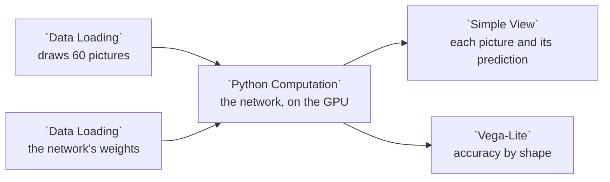

# Example: PyTorch: shape classifier

A tiny convolutional network written in PyTorch sorts 60 small pictures into circles, squares and triangles. Its node runs the network on the GPU when the machine has one and on the CPU otherwise, and prints which: `Ran on cuda.` where there is an NVIDIA GPU.

The first node draws the pictures, so the example reads no data file. The network's weights are `docs/examples/data/shape-cnn.npz`, trained on 1,500 other pictures drawn the same way by [`scripts/build_example_shape_classifier.py`](../../scripts/build_example_shape_classifier.py).

PyTorch comes with Curio's Docker image, built for CUDA 12.9, and a node there reaches the GPU when the host hands one to the container ([The GPU](../DEPLOYMENT.md#the-gpu)). Elsewhere, install `torch` into Curio's Python first.

## Pipeline overview



The pictures reach the network on its first input, `input_0`, and the weights on its second, `input_1`.

## Draw the pictures

Each picture is 64 by 64 pixels: one shape at a random size, place, turn and color, on a light ground. A square or a triangle is the part of the picture inside all of its sides, each side a half-plane. The pictures go on as PNG `data:` URIs, which `Simple View` shows as they are.

```python
# Draws 60 labeled pictures, 20 circles, 20 squares and 20 triangles, so the
# example reads no data file.
import base64
import io

import numpy as np
import pandas as pd
from PIL import Image

SHAPES = ["circle", "square", "triangle"]
SIZE = 64


def draw(shape, rng):
    """One SIZE x SIZE picture of *shape*, at a random size, place, turn and color."""
    radius = rng.uniform(13, 24)
    centre = rng.uniform(radius + 2, SIZE - radius - 2, size=2)
    turn = rng.uniform(0, 2 * np.pi)
    y, x = np.mgrid[0:SIZE, 0:SIZE] + 0.5
    dx, dy = x - centre[0], y - centre[1]
    if shape == "circle":
        inside = dx ** 2 + dy ** 2 <= radius ** 2
    else:
        # A square or a triangle in that circle: inside the half-plane of every side.
        sides = 4 if shape == "square" else 3
        apothem = radius * np.cos(np.pi / sides)
        angles = turn + 2 * np.pi * np.arange(sides) / sides
        inside = np.all([dx * np.cos(a) + dy * np.sin(a) <= apothem for a in angles], axis=0)
    ground = rng.uniform(0.85, 1.0, size=3)
    color = rng.uniform(0.05, 0.7, size=3)
    return (np.where(inside[..., None], color, ground) * 255).astype(np.uint8)


def as_data_uri(picture):
    """A PNG data: URI, which Simple View shows as it is."""
    buffer = io.BytesIO()
    Image.fromarray(picture).save(buffer, format="PNG")
    return "data:image/png;base64," + base64.b64encode(buffer.getvalue()).decode()


rng = np.random.default_rng(27)
shapes = [SHAPES[i % len(SHAPES)] for i in range(60)]
return pd.DataFrame({
    "picture": [f"P{i + 1:02d}" for i in range(len(shapes))],
    "shape": shapes,
    "image": [as_data_uri(draw(shape, rng)) for shape in shapes],
})
```

## Load the weights

`np.load` with `allow_pickle=False` reads the arrays and nothing else. The node returns them as a dictionary of lists: the tensors of the network's `state_dict`, by name.

```python
# The tiny network's weights, trained once on 1,500 other pictures drawn the
# same way (scripts/build_example_shape_classifier.py), read with no pickle.
import numpy as np

weights = np.load("docs/examples/data/shape-cnn.npz", allow_pickle=False)
return {name: weights[name].tolist() for name in weights.files}
```

## Classify on the GPU

The node builds the network, puts the weights in it and classifies the 60 pictures in one batch on `device`: `cuda` when PyTorch sees a GPU, `cpu` otherwise. Each of the four convolutions steps two pixels at a time, taking a picture from 64 by 64 to 4 by 4. The network keeps each feature's largest value anywhere in the picture, such as a sharp corner or a curve, and a linear layer weighs them into a score per shape.

The lines before the network make a rerun give the same answer. `CUBLAS_WORKSPACE_CONFIG`, set before CUDA starts, fixes the order of cuBLAS's sums; `torch.manual_seed` and `torch.use_deterministic_algorithms(True)` fix the rest; and `torch.backends.fp32_precision = "ieee"` keeps float32 math at full precision on the GPU, with no TF32. The confidence is a whole percent.

```python
import os

# Before CUDA starts, so cuBLAS repeats its sums in the same order on every run.
os.environ["CUBLAS_WORKSPACE_CONFIG"] = ":4096:8"

import base64
import io

import numpy as np
import torch
from PIL import Image

# The same numbers on every run: seeded, deterministic kernels only, and full
# float32 precision (no TF32), so every GPU rounds them alike.
torch.manual_seed(27)
torch.use_deterministic_algorithms(True)
torch.backends.fp32_precision = "ieee"
torch.backends.cudnn.benchmark = False
device = "cuda" if torch.cuda.is_available() else "cpu"

SHAPES = ["circle", "square", "triangle"]


class TinyCNN(torch.nn.Module):
    """Four strided 3 x 3 convolutions, each feature's largest value anywhere in
    the picture (a corner, a curve), and one linear layer."""

    def __init__(self):
        super().__init__()
        self.features = torch.nn.Sequential(
            torch.nn.Conv2d(3, 16, 3, stride=2, padding=1), torch.nn.ReLU(),
            torch.nn.Conv2d(16, 32, 3, stride=2, padding=1), torch.nn.ReLU(),
            torch.nn.Conv2d(32, 32, 3, stride=2, padding=1), torch.nn.ReLU(),
            torch.nn.Conv2d(32, 32, 3, stride=2, padding=1), torch.nn.ReLU(),
        )
        self.classify = torch.nn.Linear(32, len(SHAPES))

    def forward(self, pictures):
        return self.classify(self.features(pictures - 0.5).amax(dim=(2, 3)))


def pixels(uri):
    """A data: URI's picture as 3 x 64 x 64 numbers from 0 to 1."""
    png = base64.b64decode(uri.split(",", 1)[1])
    rgb = np.asarray(Image.open(io.BytesIO(png)).convert("RGB"), dtype=np.float32) / 255
    return rgb.transpose(2, 0, 1)


pictures, weights = input_0, input_1
model = TinyCNN()
model.load_state_dict({name: torch.tensor(values) for name, values in weights.items()})
model = model.to(device).eval()

batch = torch.from_numpy(np.stack([pixels(uri) for uri in pictures["image"]])).to(device)
with torch.no_grad():
    confidence, guess = torch.softmax(model(batch), dim=1).max(dim=1)
print(f"Ran on {device}.")

result = pictures[["picture", "shape"]].copy()
result["predicted"] = [SHAPES[i] for i in guess.tolist()]
# Whole percents, so every GPU shows the same ones.
result["confidence_pct"] = np.rint(confidence.cpu().numpy() * 100).astype(int)
result["device"] = device
result["image"] = pictures["image"]
return result
```

## The views

`Simple View` shows a card per picture: the picture, then its shape, the network's guess, its confidence and the device it ran on. The chart shows, for each shape, the share of its pictures the network names right.

```json
{
  "transform": [
    {
      "calculate": "datum.predicted === datum.shape ? 100 : 0",
      "as": "right"
    },
    {
      "aggregate": [
        {
          "op": "mean",
          "field": "right",
          "as": "accuracy"
        }
      ],
      "groupby": [
        "shape"
      ]
    }
  ],
  "mark": "bar",
  "encoding": {
    "x": {
      "field": "shape",
      "type": "nominal",
      "title": null,
      "axis": {
        "labelAngle": 0
      }
    },
    "y": {
      "field": "accuracy",
      "type": "quantitative",
      "title": "Named right (%)",
      "scale": {
        "domain": [
          0,
          100
        ]
      }
    },
    "color": {
      "field": "shape",
      "type": "nominal",
      "legend": null
    },
    "tooltip": [
      {
        "field": "shape"
      },
      {
        "field": "accuracy",
        "format": ".0f"
      }
    ]
  }
}
```

Change the seed in the first node, `np.random.default_rng(27)`, to draw other pictures the network has never seen.
