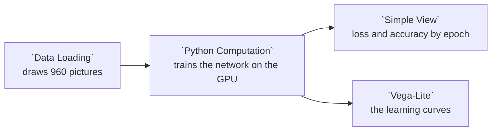

# Example: PyTorch: training on the GPU

Example 27's tiny network learns its job here, from scratch: twenty passes over 900 pictures, on the GPU when the machine has one. After each pass the node measures the training loss and the share of pictures the network names right, among the 900 it trains on and among 60 it never trains on, and a chart draws the three as they change.

PyTorch comes with Curio's Docker image, built for CUDA 12.9, and a node there reaches the GPU when the host hands one to the container ([The GPU](../DEPLOYMENT.md#the-gpu)). Elsewhere, install `torch` into Curio's Python first.

## Pipeline overview



## Draw the pictures

Example 27's drawing, with a seed of its own: 900 pictures to train on and 60 held out, which a `split` column names.

```python
# Draws 960 labeled pictures, as example 27 draws them: 900 to train on and 60
# held out, a third of each circles, squares and triangles.
import base64
import io

import numpy as np
import pandas as pd
from PIL import Image

SHAPES = ["circle", "square", "triangle"]
SIZE = 64


def draw(shape, rng):
    """One SIZE x SIZE picture of *shape*, at a random size, place, turn and color."""
    radius = rng.uniform(13, 24)
    centre = rng.uniform(radius + 2, SIZE - radius - 2, size=2)
    turn = rng.uniform(0, 2 * np.pi)
    y, x = np.mgrid[0:SIZE, 0:SIZE] + 0.5
    dx, dy = x - centre[0], y - centre[1]
    if shape == "circle":
        inside = dx ** 2 + dy ** 2 <= radius ** 2
    else:
        # A square or a triangle in that circle: inside the half-plane of every side.
        sides = 4 if shape == "square" else 3
        apothem = radius * np.cos(np.pi / sides)
        angles = turn + 2 * np.pi * np.arange(sides) / sides
        inside = np.all([dx * np.cos(a) + dy * np.sin(a) <= apothem for a in angles], axis=0)
    ground = rng.uniform(0.85, 1.0, size=3)
    color = rng.uniform(0.05, 0.7, size=3)
    return (np.where(inside[..., None], color, ground) * 255).astype(np.uint8)


def as_data_uri(picture):
    """A PNG data: URI, which Simple View shows as it is."""
    buffer = io.BytesIO()
    Image.fromarray(picture).save(buffer, format="PNG")
    return "data:image/png;base64," + base64.b64encode(buffer.getvalue()).decode()


rng = np.random.default_rng(28)
shapes = [SHAPES[i % len(SHAPES)] for i in range(960)]
return pd.DataFrame({
    "picture": [f"P{i + 1:03d}" for i in range(len(shapes))],
    "shape": shapes,
    "split": ["train"] * 900 + ["held out"] * 60,
    "image": [as_data_uri(draw(shape, rng)) for shape in shapes],
})
```

## Train on the GPU

The network starts from random weights. Each epoch shuffles the 900 pictures, takes them 30 at a time, and moves the weights against the gradient of the cross-entropy loss with Adam. Then the node measures the accuracy on both sets with the weights the network has.

The network is made on the CPU from the seed, and the shuffles are drawn there too by a generator of their own, so the network starts and trains alike on every device. With the settings example 27 describes, a rerun on the same machine gives the same numbers, which the node rounds to three decimals.

```python
import os

# Before CUDA starts, so cuBLAS repeats its sums in the same order on every run.
os.environ["CUBLAS_WORKSPACE_CONFIG"] = ":4096:8"

import base64
import io

import numpy as np
import pandas as pd
import torch
from PIL import Image

# The same numbers on every run: seeded, deterministic kernels only, and full
# float32 precision (no TF32), so every GPU rounds them alike.
torch.manual_seed(28)
torch.use_deterministic_algorithms(True)
torch.backends.fp32_precision = "ieee"
torch.backends.cudnn.benchmark = False
device = "cuda" if torch.cuda.is_available() else "cpu"

SHAPES = ["circle", "square", "triangle"]
EPOCHS = 20
BATCH = 30


class TinyCNN(torch.nn.Module):
    """Four strided 3 x 3 convolutions, each feature's largest value anywhere in
    the picture (a corner, a curve), and one linear layer."""

    def __init__(self):
        super().__init__()
        self.features = torch.nn.Sequential(
            torch.nn.Conv2d(3, 16, 3, stride=2, padding=1), torch.nn.ReLU(),
            torch.nn.Conv2d(16, 32, 3, stride=2, padding=1), torch.nn.ReLU(),
            torch.nn.Conv2d(32, 32, 3, stride=2, padding=1), torch.nn.ReLU(),
            torch.nn.Conv2d(32, 32, 3, stride=2, padding=1), torch.nn.ReLU(),
        )
        self.classify = torch.nn.Linear(32, len(SHAPES))

    def forward(self, pictures):
        return self.classify(self.features(pictures - 0.5).amax(dim=(2, 3)))


def pixels(uri):
    """A data: URI's picture as 3 x 64 x 64 numbers from 0 to 1."""
    png = base64.b64decode(uri.split(",", 1)[1])
    rgb = np.asarray(Image.open(io.BytesIO(png)).convert("RGB"), dtype=np.float32) / 255
    return rgb.transpose(2, 0, 1)


def tensors(frame):
    """A frame's pictures and the index of each one's shape, on the device."""
    images = torch.from_numpy(np.stack([pixels(uri) for uri in frame["image"]]))
    labels = torch.tensor([SHAPES.index(shape) for shape in frame["shape"]])
    return images.to(device), labels.to(device)


def accuracy(model, images, labels):
    with torch.no_grad():
        return (model(images).argmax(dim=1) == labels).float().mean().item()


train_images, train_labels = tensors(input_0[input_0["split"] == "train"])
held_images, held_labels = tensors(input_0[input_0["split"] == "held out"])

# Made on the CPU, from the seed, and the batches drawn there too, so the
# network starts and trains alike on every device.
model = TinyCNN().to(device)
optimizer = torch.optim.Adam(model.parameters(), lr=0.005)
shuffle = torch.Generator().manual_seed(28)

history = []
for epoch in range(1, EPOCHS + 1):
    model.train()
    total = 0.0
    for batch in torch.randperm(len(train_labels), generator=shuffle).split(BATCH):
        batch = batch.to(device)
        loss = torch.nn.functional.cross_entropy(model(train_images[batch]), train_labels[batch])
        optimizer.zero_grad()
        loss.backward()
        optimizer.step()
        total += loss.item() * len(batch)
    model.eval()
    history.append({
        "epoch": epoch,
        # Three decimals, so every GPU shows the same numbers.
        "loss": round(total / len(train_labels), 3),
        "train_accuracy": round(accuracy(model, train_images, train_labels), 3),
        "held_out_accuracy": round(accuracy(model, held_images, held_labels), 3),
        "device": device,
    })
print(f"Ran on {device}.")

return pd.DataFrame(history)
```

## The views

`Simple View` lists the twenty epochs: the loss, both accuracies and the device. The chart draws the three by epoch: the loss falls as the accuracy rises, and the held-out accuracy says how well the network does on pictures it never saw.

```json
{
  "transform": [
    {
      "fold": [
        "loss",
        "train_accuracy",
        "held_out_accuracy"
      ],
      "as": [
        "measure",
        "value"
      ]
    }
  ],
  "mark": {
    "type": "line",
    "point": true
  },
  "encoding": {
    "x": {
      "field": "epoch",
      "type": "quantitative",
      "title": "Epoch",
      "axis": {
        "tickMinStep": 1
      }
    },
    "y": {
      "field": "value",
      "type": "quantitative",
      "title": null
    },
    "color": {
      "field": "measure",
      "type": "nominal",
      "title": null,
      "sort": [
        "loss",
        "train_accuracy",
        "held_out_accuracy"
      ]
    },
    "tooltip": [
      {
        "field": "epoch"
      },
      {
        "field": "measure"
      },
      {
        "field": "value",
        "format": ".3f"
      }
    ]
  }
}
```
