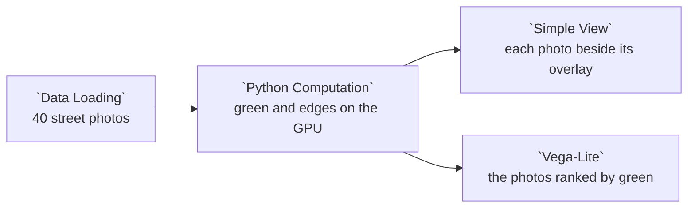

# Example: PyTorch: street photos

Example 10's 40 Mapillary photos around Lincoln Park, measured with convolutions in PyTorch on the GPU when the machine has one: the share of each photo that is green, and the share that is edges. The node writes an overlay of both per photo, which `Simple View` shows beside the photo.

PyTorch comes with Curio's Docker image, built for CUDA 12.9, and a node there reaches the GPU when the host hands one to the container ([The GPU](../DEPLOYMENT.md#the-gpu)). Elsewhere, install `torch` into Curio's Python first.

## Pipeline overview



## Load the photos

The Data Catalog's Mapillary sample, one row per photo, with the `path` the next node opens, the `thumbnail` `Simple View` shows, and each photo's photographer, `creator`. Mapillary photos are licensed CC BY-SA 4.0, so a figure made from them credits each photo's `creator`.

```python
photos = curio_load_collection("data.curio.mapillary-sample")

return photos
```

## Measure on the GPU

Each measure is a convolution over the photo on `device`:

- green: `2G - R - B`, a 1 x 1 convolution over the color channels, then a 5 x 5 mean;
  a pixel is green where it passes `GREEN`;
- edges: the brightness, another 1 x 1 convolution, then Sobel's two 3 x 3 gradients;
  a pixel is on an edge where the change passes `EDGE`.

The overlay dims the photo and paints its green pixels green and its edges white. The node writes it to the file `curio_derived_file` names for it, whose `image_url` goes in `overlay_url`. The shares are rounded to one decimal.

```python
import os

# Before CUDA starts, so cuBLAS repeats its sums in the same order on every run.
os.environ["CUBLAS_WORKSPACE_CONFIG"] = ":4096:8"

import numpy as np
import pandas as pd
import torch
import torch.nn.functional as F
from PIL import Image

# The same numbers on every run: seeded, deterministic kernels only, and full
# float32 precision (no TF32), so every GPU rounds them alike.
torch.manual_seed(29)
torch.use_deterministic_algorithms(True)
torch.backends.fp32_precision = "ieee"
torch.backends.cudnn.benchmark = False
device = "cuda" if torch.cuda.is_available() else "cpu"

#: A pixel is green when 2G - R - B, smoothed over 5 x 5 pixels, passes this.
GREEN = 0.1
#: A pixel is on an edge when the brightness changes by more than this a pixel.
EDGE = 0.2

# Each measure is a convolution: weights over the color channels, a 5 x 5
# mean, and Sobel's two 3 x 3 gradients of the brightness.
excess_green = torch.tensor([-1.0, 2.0, -1.0]).view(1, 3, 1, 1).to(device)
smooth = torch.full((1, 1, 5, 5), 1 / 25).to(device)
brightness = torch.tensor([0.299, 0.587, 0.114]).view(1, 3, 1, 1).to(device)
sobel = torch.tensor([[-1.0, 0.0, 1.0], [-2.0, 0.0, 2.0], [-1.0, 0.0, 1.0]])
gradients = torch.stack([sobel, sobel.T]).unsqueeze(1).to(device) / 4

rows = []
for photo in input_0.itertuples():
    with Image.open(photo.path) as source:
        rgb = np.asarray(source.convert("RGB"), dtype=np.float32) / 255
    image = torch.from_numpy(rgb).permute(2, 0, 1).unsqueeze(0).to(device)
    green = F.conv2d(F.conv2d(image, excess_green), smooth, padding=2) > GREEN
    change = F.conv2d(F.conv2d(image, brightness), gradients, padding=1)
    edges = change.square().sum(dim=1, keepdim=True).sqrt() > EDGE

    # The overlay: the photo dimmed, its green pixels green and its edges white.
    overlay = image * 0.5
    overlay = torch.where(green, torch.tensor([0.2, 0.8, 0.3], device=device).view(1, 3, 1, 1), overlay)
    overlay = torch.where(edges, torch.ones(1, 3, 1, 1, device=device), overlay)
    picture = (overlay[0].permute(1, 2, 0).cpu().numpy() * 255).round().astype(np.uint8)
    derived = curio_derived_file(photo.dataset_id, photo.file_id, 0, "png", kind="image", tag="greenedges")
    Image.fromarray(picture).save(derived["path"])

    rows.append({
        "image_id": photo.image_id,
        "creator": photo.creator,
        # One decimal, so every GPU shows the same numbers.
        "green_pct": round(green.float().mean().item() * 100, 1),
        "edge_pct": round(edges.float().mean().item() * 100, 1),
        "device": device,
        "thumbnail": photo.thumbnail,
        "overlay_url": derived["image_url"],
    })
print(f"Ran on {device}.")

return pd.DataFrame(rows)
```

## The views

Each `Simple View` card shows the photo and its overlay, with the photo's id, its photographer, its shares and the device. The chart ranks the photos by their green share and shades each bar by its edges.

```json
{
  "mark": "bar",
  "encoding": {
    "y": {
      "field": "image_id",
      "type": "nominal",
      "sort": "-x",
      "title": "Photos, greenest first",
      "axis": {
        "labels": false,
        "ticks": false
      }
    },
    "x": {
      "field": "green_pct",
      "type": "quantitative",
      "title": "Green (% of pixels)"
    },
    "color": {
      "field": "edge_pct",
      "type": "quantitative",
      "title": "Edges (%)",
      "scale": {
        "scheme": "viridis"
      }
    },
    "tooltip": [
      {
        "field": "image_id"
      },
      {
        "field": "creator"
      },
      {
        "field": "green_pct"
      },
      {
        "field": "edge_pct"
      }
    ]
  }
}
```
