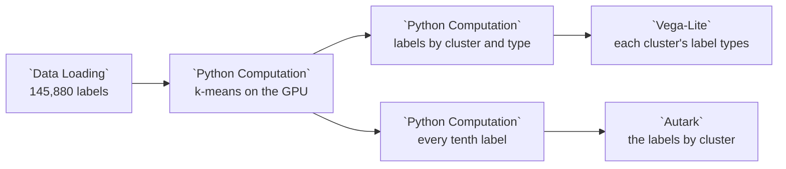

# Example: PyTorch: sidewalk clusters

Project Sidewalk's volunteers have labeled 145,880 places on Chicago's sidewalks: curb ramps, missing ramps, obstacles, surface problems and more. This example groups the labels by place with k-means, in PyTorch on the GPU when the machine has one, maps them by cluster with Autark, and charts the types of label in each cluster.

PyTorch comes with Curio's Docker image, built for CUDA 12.9, and a node there reaches the GPU when the host hands one to the container ([The GPU](../DEPLOYMENT.md#the-gpu)). Elsewhere, install `torch` into Curio's Python first.

## Pipeline overview



## Load the labels

```python
labels = curio_load_data("data.projectsidewalk.chicago-labels")

return labels[["label_type", "severity", "neighborhood", "geometry"]]
```

## Cluster on the GPU

k-means puts each label in the cluster whose centre is nearest, then moves each centre to the mean of its labels, until no label changes cluster. The node does it for all 145,880 labels at once on `device`:

- the labels' places are in metres (Illinois East), around their mean, in float64;
- the first centre is a random label, and each next one a label drawn with odds by its
  squared distance to the nearest centre so far (k-means++);
- each step's distances are one tensor of labels by centres, and the new centres the
  product of the labels' one-hot clusters with their places.

The random draws come from a seeded generator on the CPU, and the clusters are numbered from the largest, so a rerun gives the same clusters.

```python
import os

# Before CUDA starts, so cuBLAS repeats its sums in the same order on every run.
os.environ["CUBLAS_WORKSPACE_CONFIG"] = ":4096:8"

import numpy as np
import torch

# The same numbers on every run: seeded, deterministic kernels only, and full
# float32 precision (no TF32), so every GPU rounds them alike.
torch.manual_seed(30)
torch.use_deterministic_algorithms(True)
torch.backends.fp32_precision = "ieee"
torch.backends.cudnn.benchmark = False
device = "cuda" if torch.cuda.is_available() else "cpu"

K = 8

# Each label's place in metres (Illinois East), around the labels' mean, in
# float64, so every device puts each label in the same cluster.
metres = input_0.geometry.to_crs(26971)
xy = np.column_stack([metres.x, metres.y])
points = torch.from_numpy(xy - xy.mean(axis=0)).to(device)


def squared_distances(centres):
    """Every label's squared distance to every centre, labels by centres."""
    return (points[:, None, :] - centres[None, :, :]).square().sum(dim=2)


# k-means++ starts: each next centre a label drawn with odds by its squared
# distance to the nearest centre so far, by a generator on the CPU, so every
# device draws the same ones.
draws = torch.Generator().manual_seed(30)
centres = points[torch.randint(len(points), (1,), generator=draws).to(device)]
for _ in range(K - 1):
    nearest = squared_distances(centres).min(dim=1).values
    pick = torch.multinomial((nearest / nearest.sum()).cpu(), 1, generator=draws)
    centres = torch.cat([centres, points[pick.to(device)]])

# Lloyd's steps until no label changes cluster: each centre moves to the mean
# of its labels, a product with the labels' one-hot clusters.
assigned = None
for step in range(1, 101):
    closest = squared_distances(centres).argmin(dim=1)
    if assigned is not None and torch.equal(closest, assigned):
        break
    assigned = closest
    members = torch.nn.functional.one_hot(assigned, K).to(points.dtype)
    centres = (members.T @ points) / members.sum(dim=0).clamp(min=1)[:, None]
print(f"Ran on {device}: {K} clusters, settled after {step} steps.")

# Clusters numbered from the largest, 1 to K.
sizes = torch.nn.functional.one_hot(assigned, K).sum(dim=0).cpu()
rank = torch.empty(K, dtype=torch.long)
rank[torch.argsort(sizes, descending=True, stable=True)] = torch.arange(K)

clustered = input_0.copy()
clustered["cluster"] = (rank[assigned.cpu()] + 1).numpy()
clustered["device"] = device
return clustered
```

## Count and thin

One node counts each cluster's labels by type, for the chart:

```python
# How many labels of each type each cluster holds.
counts = input_0.groupby(["cluster", "label_type"]).size()

return counts.reset_index(name="labels")
```

Another keeps every tenth label for the map:

```python
# Every tenth label, enough to show the clusters on a map.
return input_0.iloc[::10][["cluster", "label_type", "geometry"]]
```

## The views

The Autark map draws the labels it gets in their cluster's color:

```json
{
  "map": {
    "layerRefs": [
      {
        "dataRef": "[!! input_0 !!]",
        "getFnv": "cluster",
        "getFnvType": "categorical",
        "colorMapInterpolator": "schemeTableau10",
        "title": "Cluster"
      }
    ]
  }
}
```

and the chart stacks each cluster's labels by type:

```json
{
  "mark": "bar",
  "encoding": {
    "x": {
      "field": "cluster",
      "type": "ordinal",
      "title": "Cluster",
      "axis": {
        "labelAngle": 0
      }
    },
    "y": {
      "field": "labels",
      "type": "quantitative",
      "aggregate": "sum",
      "title": "Labels"
    },
    "color": {
      "field": "label_type",
      "type": "nominal",
      "title": "Label type"
    },
    "tooltip": [
      {
        "field": "cluster"
      },
      {
        "field": "label_type"
      },
      {
        "field": "labels"
      }
    ]
  }
}
```
