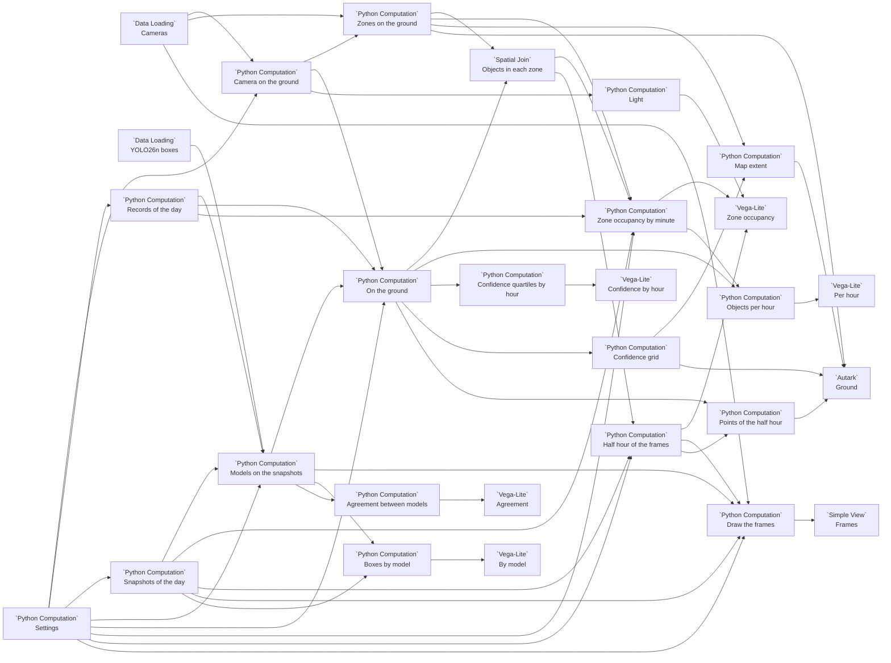

# Example: SAGE-IDOT rail crossings

Three SAGE nodes watch rail crossings of the Illinois Department of Transportation (IDOT): W042, W065 and W06E, each a camera that takes a snapshot every 5 minutes and runs three YOLO models, YOLOv5n, YOLOv8n and YOLOv10n, on a new image about every 3 seconds. This example follows the analyses of the Cities in Motion workshop team ([isalva2/cities-in-motion-video](https://github.com/isalva2/cities-in-motion-video)) on the day the team studied at each camera: it places every object a model saw on the ground, measures how full each lane before and after the crossing gets minute by minute, against night, twilight and day, draws a half hour's snapshots with every model's boxes, and compares the three models with YOLO26n, which the team ran on the snapshots.

Its dashboard shows eight tiles: the settings, the zone occupancy, the frames, the ground, objects per hour, confidence by hour, boxes by model and the models' agreement.

## The data, read where they are

Everything the example reads of SAGE stays in the `idot` bucket on data.urbantk.org, which the [Discovery Catalog](../DISCOVERY-CATALOG.md)'s SAGE-IDOT rail crossings source lists. Six datasets of the Data Catalog list its files, and each reads them in place where the deployment mounts the bucket:

- `data.sage.idot-w042-records-2025-08`, `data.sage.idot-w065-records-2025-08` and `data.sage.idot-w06e-records-2025-12`: each camera's month of records, one JSON Lines file of 1.4 to 1.6 GB;
- `data.sage.idot-w042-snapshots-2025-08-09`, `data.sage.idot-w065-snapshots-2025-08-17` and `data.sage.idot-w06e-snapshots-2025-12-02`: the snapshots of each camera's day, 288, 246 and 288.

On a Curio that mounts no bucket, open each dataset's details in the Data Catalog and press **Cache files** first.

Two more datasets hold the team's own files: `data.cities-in-motion.idot-cameras`, each camera's control points, which tie pixels of its snapshots to the ground in UTM zone 16N (EPSG:26916), and its four zones, a lane before or after the crossing each, in pixels; and `data.cities-in-motion.idot-yolo26n`, Keira's YOLO26n boxes on the snapshots.

## Pipeline overview



## Settings

The Settings node holds the dashboard's controls, and every node that reads one of them is wired to it: the camera and its day, the model, the classes, the lowest confidence kept, from 0.25, every model's lowest, to 0.95, and the half hour the frames show. **Busiest** picks the half hour whose snapshots show the most objects in the lanes before the crossing; the times are on a Chicago clock, each one that all three days cover.

```python
# The dashboard's controls, read by every node wired to this one: the camera
# and its day, the model, the classes, the lowest confidence kept, and the
# half hour the frames show.
camera = [!! camera !!]
model = [!! model !!]

return {
    "camera": camera.split(" ")[0],
    "model": model.split(" ")[0],
    "classes": [!! classes !!],
    "confidence": [!! confidence !!],
    "frames_from": [!! frames_from !!],
}
```

## The camera on the ground

A camera's homography is the 3 by 3 matrix that takes a pixel of its snapshots to the ground. **Camera on the ground** fits it to the camera's control points by least squares, in float64, after Hartley's normalization of both sets of points. W042 has four control points, which the homography fits exactly; W065's six and W06E's five it misses by about half a metre on average, its `fit_error_m`. It also gives the camera's latitude and longitude, the middle of its control points, for the light.

**Zones on the ground** takes each zone's corners through the homography, so each zone is a polygon in metres and its area is in square metres:

```python
import geopandas as gpd
import numpy as np
from shapely.geometry import Polygon

# The camera's four zones on the ground: each zone's corners in pixels taken
# through the camera's homography to metres in UTM zone 16N (EPSG:26916), so
# its area is in square metres.
camera, cameras = input_0, input_1
h = np.array(camera["h"])
corners = cameras[(cameras["camera"] == camera["camera"]) & (cameras["kind"] == "zone")]
names, shapes = [], []
for zone, part in corners.sort_values("point", kind="stable").groupby("zone", sort=False):
    u, v, w = h @ np.vstack([part["x_px"], part["y_px"], np.ones(len(part))])
    names.append(zone)
    shapes.append(Polygon(zip(u / w, v / w)))
zones = gpd.GeoDataFrame({"zone": names}, geometry=shapes, crs=26916)
zones["area_m2"] = zones.area
zones["before_the_crossing"] = zones["zone"].str.contains("before")
zones.metadata = {"layerType": "polygons"}
return zones
```

## The records of the day

A month's file runs day by day: each UTC day is one block of lines, first a line per image the models looked at, in time order, then a line per snapshot uploaded. A line's date never goes down through the file, so **Records of the day** bisects on the dates for where the day starts and where the next one does, and reads only that block, 49 to 58 MB of the month's 1.4 to 1.6 GB. It gives one row per box and one row with no class for each image a model saw nothing in:

```python
import json
import os
from datetime import date, timedelta

import pandas as pd

# The camera's records of its day, a UTC date, out of its month's JSON Lines
# file, read where it is. The month runs day by day, each day's lines in a
# block: one line per image the models looked at, in time order, then one per
# snapshot uploaded. A line's date never goes down, so a bisection on the
# dates finds where the day starts and where the next one does, and only
# those bytes are read.
DAYS = {"W042": "2025-08-09", "W065": "2025-08-17", "W06E": "2025-12-02"}
MONTHS = {
    "W042": curio_load_collection("data.sage.idot-w042-records-2025-08"),
    "W065": curio_load_collection("data.sage.idot-w065-records-2025-08"),
    "W06E": curio_load_collection("data.sage.idot-w06e-records-2025-12"),
}
camera = input_0["camera"]
path = MONTHS[camera]["path"].iloc[0]
if pd.isna(path):
    raise RuntimeError(
        f"The records of {camera} are not on this machine: open their dataset's details in the "
        "Data Catalog and press Cache files."
    )


def first_line_from(handle, size, day):
    """Where the first line dated *day* or later starts."""
    low, high = 0, size
    while low < high:
        middle = (low + high) // 2
        handle.seek(middle)
        if middle:
            handle.readline()  # the rest of the line the seek fell in
        line = handle.readline()
        if line and json.loads(line)["timestamp"][:10] < day:
            low = middle + 1
        else:
            high = middle
    handle.seek(low)
    if low:
        handle.readline()
    return handle.tell()


day = DAYS[camera]
next_day = (date.fromisoformat(day) + timedelta(days=1)).isoformat()
with open(path, "rb") as handle:
    size = os.fstat(handle.fileno()).st_size
    start = first_line_from(handle, size, day)
    end = first_line_from(handle, size, next_day)
    handle.seek(start)
    lines = handle.read(end - start).splitlines()

# One row per box a model drew, and one with no class for an image the model
# saw nothing in, as the team's get_detections_df reads the records.
rows = []
for line in lines:
    record = json.loads(line)  # its meta.filename may be a bare NaN, which Python reads
    if record["name"] != "object.detections.all":
        continue  # a snapshot's upload line
    value = json.loads(record["value"])
    for model, result in value["models_results"].items():
        for box in result.get("detections") or [{}]:
            x0, y0, x1, y1 = box.get("bbox", [None] * 4)
            rows.append((value["image_timestamp_ns"], model, box.get("class"), box.get("confidence"), x0, y0, x1, y1))
records = pd.DataFrame(rows, columns=["image_timestamp_ns", "model", "class", "confidence", "x0", "y0", "x1", "y1"])
print(f"{camera} on {day}: {end - start:,} bytes from {start:,}, {records['image_timestamp_ns'].nunique():,} images")
return records
```

**Snapshots of the day** lists the camera's snapshots, each named by when it was taken in nanoseconds, the same number as the records' `image_timestamp_ns` of that image, with its time on a Chicago clock.

## On the ground

An object stands where its box meets the ground: the bottom center of the box, `((x0 + x1) / 2, y1)`. **On the ground** takes it through the homography for the chosen model, classes and confidence. The classes hold no traffic light, which is not on the ground. YOLO26n ran on the snapshots alone, so its points come from **Models on the snapshots**, Keira's boxes joined to the snapshots by their names.

```python
import geopandas as gpd
import numpy as np
import pandas as pd

# Where each object the chosen model saw stands on the ground: the bottom
# center of its box, ((x0 + x1) / 2, y1), where it meets the ground, taken
# through the camera's homography to metres in UTM zone 16N (EPSG:26916), of
# the chosen classes at the chosen confidence or more. The classes hold no
# traffic light, which is not on the ground. A point more than RANGE_M from
# the control points is left out: its box stands near the horizon, where a
# pixel spans many metres. YOLO26n ran on the snapshots alone, so its points
# are its boxes there.
RANGE_M = 100
settings, camera, records, on_snapshots = input_0, input_1, input_2, input_3
if settings["model"] == "YOLO26n":
    boxes = on_snapshots[on_snapshots["model"] == "YOLO26n"]
else:
    boxes = records[records["model"] == settings["model"]]
    boxes = boxes[boxes["class"].isin(settings["classes"]) & (boxes["confidence"] >= settings["confidence"])]

h = np.array(camera["h"])
u, v, w = h @ np.vstack([(boxes["x0"] + boxes["x1"]) / 2, boxes["y1"], np.ones(len(boxes))])
points = boxes.assign(easting_m=u / w, northing_m=v / w)
away = np.hypot(points["easting_m"] - camera["easting_m"], points["northing_m"] - camera["northing_m"])
points = points[(w > 0) & (away <= RANGE_M)].reset_index(drop=True)
taken_at = pd.to_datetime(points["image_timestamp_ns"], unit="ns", utc=True)
points["chicago"] = taken_at.dt.tz_convert("America/Chicago").dt.tz_localize(None)
print(f"{len(points):,} of {len(boxes):,} boxes stand within {RANGE_M} m of the control points")
geometry = gpd.points_from_xy(points["easting_m"], points["northing_m"])
points = gpd.GeoDataFrame(points, geometry=geometry, crs=26916)
points.metadata = {"layerType": "points"}
return points
```

The Spatial Join node, with the operation `within`, pairs each point with the zone it lies in.

## Zone occupancy

**Zone occupancy by minute** counts the objects in each zone per image, per 100 square metres, minute by minute. Every image the model looked at counts, one it saw nothing in too, whatever the filters keep. YOLO26n looked at a snapshot every 5 minutes, so its bins are 5 minutes long.

```python
import pandas as pd

# How full each zone is, minute by minute: the objects in it per image, per
# 100 square metres of the zone. Every image the model looked at counts, one it
# saw nothing in too, whatever the filters keep: the distinct images of the
# model in the records. YOLO26n looked at the snapshots alone, one every 5
# minutes, so its bins are 5 minutes long.
settings, records, snapshots, zones, inside = input_0, input_1, input_2, input_3, input_4
if settings["model"] == "YOLO26n":
    images, step = snapshots["ns"], "5min"
else:
    images, step = records.loc[records["model"] == settings["model"], "image_timestamp_ns"].unique(), "1min"


def binned(ns):
    """Each time in nanoseconds as the start of its bin, on a Chicago clock."""
    chicago = pd.to_datetime(pd.Series(ns), unit="ns", utc=True).dt.tz_convert("America/Chicago")
    return chicago.dt.floor(step).dt.tz_localize(None).to_numpy()


looked = pd.Series(binned(images)).value_counts().rename("images")
found = inside.groupby([binned(inside["image_timestamp_ns"]), "zone"]).size()
bins = pd.MultiIndex.from_product([looked.index.sort_values(), zones["zone"]], names=["bin", "zone"])
occupancy = found.reindex(bins, fill_value=0).rename("objects").reset_index()
occupancy = occupancy.join(looked, on="bin").merge(zones[["zone", "area_m2"]], on="zone")
occupancy["per_image_per_100_m2"] = occupancy["objects"] / occupancy["images"] / occupancy["area_m2"] * 100
# The Chicago clock written as if it were UTC, so a chart draws the same hours in
# a browser anywhere.
occupancy["time"] = occupancy["bin"].dt.strftime("%Y-%m-%dT%H:%M:%SZ")
occupancy["clock"] = occupancy["bin"].dt.strftime("%H:%M")
return occupancy
```

**Light** takes night, twilight and day at the camera from astral's dawn, sunrise, sunset and dusk, for each Chicago date the UTC day touches. W042's day, 9 August 2025 in UTC, runs from 19:00 on 8 August to 19:00 on 9 August in Chicago: day until sunset at 19:59, twilight until 20:30, night until 05:22, twilight until 05:53, then day. The occupancy chart draws them as bands behind a line per zone, with the half hour of the frames in orange.

## Frames

**Half hour of the frames** picks the half hour: the one **Frames from** names, or the busiest. **Draw the frames** draws up to six of its snapshots with PIL, with the zones in yellow and the chosen model's boxes colored by class, each as a picture derived from its snapshot, whose tag names the model, classes and confidence it was drawn with. Each card's caption gives the snapshot's Chicago time and every model's count of boxes on it, of the chosen classes at the chosen confidence. A Simple View shows the cards.

## The ground

**Confidence grid** averages the confidence of the day's ground points on cells of 2 m. The Autark map draws the zones, the grid and the ground points of the half hour, each point a disc of half a metre's radius on the ground:

```json
{
  "map": {
    "layerRefs": [
      {
        "dataRef": "[!! input_3 !!]",
        "getFnv": "class",
        "getFnvType": "categorical",
        "pointSize": 0.5,
        "title": "Objects of the half hour"
      }
    ]
  }
}
```

A map clips every layer after its first to its first's outline, so **Map extent** gives it one rectangle of ground around the zones and the grid, drawn first.

## The models on the snapshots

**Models on the snapshots** gathers every model's boxes on the day's snapshots, YOLOv5n's, YOLOv8n's and YOLOv10n's from the records and YOLO26n's from Keira's run, of the chosen classes at the chosen confidence. **Boxes by model** shares each model's boxes over the snapshots, a snapshot it found nothing in counted too. **Agreement between models** gives the share of one model's boxes that another finds too: a box of the same class on the same snapshot that overlaps it by an intersection over union of 0.5 or more.

```python
import numpy as np
import pandas as pd

# How often two models agree on the snapshots: the share of one model's boxes
# that the other model finds too, a box of the same class on the same snapshot
# overlapping it by an intersection over union (IoU) of IOU or more. Each
# model finds all its own boxes.
IOU = 0.5
MODELS = ["YOLOv5n", "YOLOv8n", "YOLOv10n", "YOLO26n"]
boxes = input_0


def area(boxes):
    return (boxes[:, 2] - boxes[:, 0]) * (boxes[:, 3] - boxes[:, 1])


def overlaps(a, b):
    """The IoU of every box of *a* with every box of *b*, boxes as rows of x0, y0, x1, y1."""
    width = np.minimum(a[:, None, 2], b[None, :, 2]) - np.maximum(a[:, None, 0], b[None, :, 0])
    height = np.minimum(a[:, None, 3], b[None, :, 3]) - np.maximum(a[:, None, 1], b[None, :, 1])
    shared = width.clip(min=0) * height.clip(min=0)
    return shared / (area(a)[:, None] + area(b)[None, :] - shared)


found = {(one, other): 0 for one in MODELS for other in MODELS}
total = dict.fromkeys(MODELS, 0)
for _key, part in boxes.groupby(["image_timestamp_ns", "class"]):
    corners = {model: rows[["x0", "y0", "x1", "y1"]].to_numpy(float) for model, rows in part.groupby("model")}
    for one, mine in corners.items():
        total[one] += len(mine)
        for other, theirs in corners.items():
            found[one, other] += int((overlaps(mine, theirs) >= IOU).any(axis=1).sum())
return pd.DataFrame([
    {"model": one, "other": other, "share": found[one, other] / total[one] if total[one] else None,
     "boxes": total[one]}
    for one in MODELS for other in MODELS
])
```

## The dashboard

The dashboard pins Settings, Zone occupancy, Frames, Ground, Per hour, Confidence by hour, By model and Agreement. A viewer who changes a setting reruns the tiles it reaches on the server. Each tile reads a small node above it, a summary or the map's layers, so the page stays small.

## Credits

The control points, the zones and the YOLO26n boxes are the Cities in Motion workshop team's, from [isalva2/cities-in-motion-video](https://github.com/isalva2/cities-in-motion-video): Joao's control points, Zahra's zones and Keira's YOLO26n run. The records and the snapshots are SAGE's, from its nodes at IDOT's rail crossings. Both are used with the permission of their authors.
