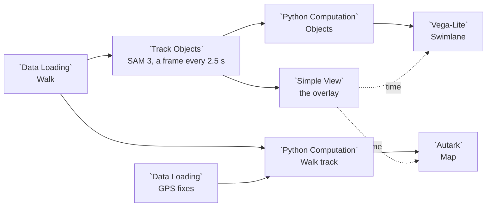

# Example: SideSeeing: objects tracked along a walk

A walk along the sidewalks of Chicago's West Loop on 2026-10-26, recorded with the SideSeeing app on a phone that looks down at the sidewalk: 14 minutes of video, and a GPS fix about every half second. SAM 3 looks for nine kinds of sidewalk object through the whole video, a frame every 2.5 s, and `Simple View` plays the overlay it draws. The player is linked to two views by interaction edges: as the video plays, each object's bar on a swimlane turns from gray to its label's color once the video passes the moment SAM 3 first saw it, and the walk's GPS fixes on an Autark map of its streets, up to where the video stands, take Autark's highlight color in place of their colors by time.

Tracking the whole walk takes about 3.5 minutes on dev.urbantk.org's GPU. The first run downloads SAM 3's weights, 3.4 GB, from Hugging Face ([Model Catalog](../MODEL-CATALOG.md)).

## Pipeline overview



## Data

- **SideSeeing West Loop walk** (`data.sideseeing.west-loop-walk`): the walk's video, 2.6 GB, with faces and license plates blurred.
- **SideSeeing West Loop walk GPS track** (`data.sideseeing.west-loop-walk-gps`): its `gps.csv`, 1,292 fixes, each with `datetime_utc`, `latitude`, `longitude` and `accuracy` in meters.

Both stay in the SideSeeing bucket on data.urbantk.org. Where Curio mounts the bucket, the nodes read them in place. Elsewhere, open each one's details in the Data Catalog and press **Cache files** first: 2.6 GB for the video. The streets come from `docs/examples/data/west_loop.osm.pbf`, an OpenStreetMap extract of the box around the walk.

## Load the walk

One row: the video, with the `path` the next node opens, its `taken_at`, when the walk began, in UTC, and its length, frame rate and size.

```python
walk = curio_load_collection("data.sideseeing.west-loop-walk")

return walk
```

## Track the objects

`Track Objects` is the node of SAM 3's model package, `model.curio.sam3@1`, which this dataflow declares. Its Widgets tab holds its settings: **Labels**, the eight it ships with and "wheelchair ramp", and **Gap between frames**, 2.5 s. Its code lets an object go once SAM 3 has not seen it for 10 s. At a frame every 2.5 s the walk is 346 frames, under **Maximum frames per video**, 450.

```python
from sam3_tracking import track_objects

FORGET_SECONDS = 10  # SAM 3 lets go of an object unseen this long; None keeps every object
TO_SECONDS = None  # where the part of each video ends; None is the video's end

return track_objects(
    input_0, curio_load_model("model.curio.sam3"), curio_derived_file,
    labels=[!! labels !!], every_seconds=float([!! every_seconds !!]), forget_seconds=FORGET_SECONDS,
    from_seconds=float([!! from_seconds !!]), to_seconds=TO_SECONDS,
    max_frames=int([!! max_frames !!]), width=int([!! width !!]),
)
```

It gives back two tables. `videos` is the video as its overlay, the frames SAM 3 looked at with each object's mask and id drawn, with `t_s`, where the overlay starts in the video, and a count of the objects of each label. `tracks` has one row per object it followed.

## Play the overlay

`Simple View` shows the two tables as tabs, and plays the overlay in the first, `videos`, each frame for 2.5 s, so it keeps time with the walk. Its interaction edges link the player to the swimlane and to the map: what the player has played, from the video's start to where it stands, is a range on `t_s`, and each view marks its rows whose `t_s` is in the range: the swimlane draws their bars in their label's color, and the map draws their fixes in Autark's highlight color. A seek back marks fewer.

## One row per object

The node reads Track Objects' `tracks` by its key, with the chip `[!! input_0:tracks !!]`, and gives each object `t_s`.

```python
# One row per object Track Objects followed: its tracks table, read by its
# key. t_s, the time the player's range is matched on, is when SAM 3 first
# saw the object, so its bar takes its label's color from there.
objects = [!! input_0:tracks !!]
objects["t_s"] = objects["start_s"]

return objects
```

## The swimlane

A lane for each label SAM 3 found an object of, and one bar per object, from `start_s`, when SAM 3 first saw it, to `end_s`, when it last did. A label it finds nothing of has no lane, so the swimlane can have fewer lanes than `LABELS` names. A bar takes its label's color once the player has played past its first sighting, and is gray before.

```json
{
  "mark": {
    "type": "bar",
    "strokeWidth": 2
  },
  "encoding": {
    "y": {
      "field": "label",
      "type": "nominal",
      "title": null
    },
    "x": {
      "field": "start_s",
      "type": "quantitative",
      "title": "Seconds into the walk"
    },
    "x2": {
      "field": "end_s"
    },
    "color": {
      "condition": {
        "test": "datum.interacted === '1'",
        "field": "label",
        "type": "nominal",
        "legend": null
      },
      "value": "#c8c8c8"
    }
  }
}
```

The spec gives `stroke` the same colors, so an object seen in one frame only, whose bar has no length, shows too.

## Load the GPS track

One row: the walk's `gps.csv`, with the `path` the next node opens.

```python
gps = curio_load_collection("data.sideseeing.west-loop-walk-gps")

return gps
```

## The walk's track

The node reads the CSV in place and gives each fix `t_s`, its `datetime_utc` less the walk's `taken_at`, as a point.

```python
import geopandas as gpd
import pandas as pd

walk, gps = [!! input_0 !!], [!! input_1 !!]

# The walk's GPS fixes, read in place from the gps.csv the GPS track's row names.
path = gps["path"].iloc[0]
if not path:
    raise ValueError("gps.csv is not on this machine yet: cache the GPS track's files in the Data Catalog first")
fixes = pd.read_csv(path)

# t_s, each fix's time in the walk, in seconds, which the player's range is
# matched on: its datetime_utc less the walk's taken_at, both in UTC.
taken_at = pd.to_datetime(walk["taken_at"].iloc[0], utc=True)
fixes["t_s"] = (pd.to_datetime(fixes["datetime_utc"], utc=True) - taken_at).dt.total_seconds()

return gpd.GeoDataFrame(
    fixes, geometry=gpd.points_from_xy(fixes["longitude"], fixes["latitude"]), crs="EPSG:4326",
)
```

The video starts 0.36 s after `taken_at` (`mediaStartDateTime` in the walk's `metadata.json`), so a fix takes the highlight color 0.36 s after the video passes its place.

## The map

The streets of the extract, with the fixes on top, colored by their time in the walk. `pointSize` is a point's radius in meters on the ground, so each fix is a disc 8 m across. The fixes are the layer that picks, which is the one the player's range marks: each fix up to where the video stands takes Autark's highlight color in place of its color by time.

```json
{
  "data": [
    {
      "type": "osm",
      "pbfFileUrl": "docs/examples/data/west_loop.osm.pbf",
      "queryArea": {
        "bbox": [
          -87.6593,
          41.8746,
          -87.6548,
          41.8836
        ]
      },
      "outputTableName": "table_osm",
      "autoLoadLayers": {
        "layers": [
          "roads"
        ]
      }
    }
  ],
  "map": {
    "layerRefs": [
      {
        "dataRef": "table_osm_roads"
      },
      {
        "dataRef": "[!! input_0 !!]",
        "isPick": true,
        "pointSize": 4,
        "getFnv": "t_s",
        "getFnvType": "quantitative",
        "colorMapInterpolator": "interpolateViridis",
        "title": "Seconds into the walk"
      }
    ]
  }
}
```

## Good to know

- **A run looks at 450 frames of a video at most, its Maximum frames per video.** A smaller **Gap between frames** takes more frames of the walk, and past 450 the node stops before SAM 3 loads and says which part fits; **Track from** and `TO_SECONDS` pick a part.
- **Each setting keeps an overlay of its own.** A run that asks other labels, frames, forgetting, part or width than an earlier one writes an overlay of its own; one that asks the same writes the earlier run's again.
- **The labels are words.** SAM 3 takes any short noun phrase; the Model Catalog lists the 35 the package suggests.
