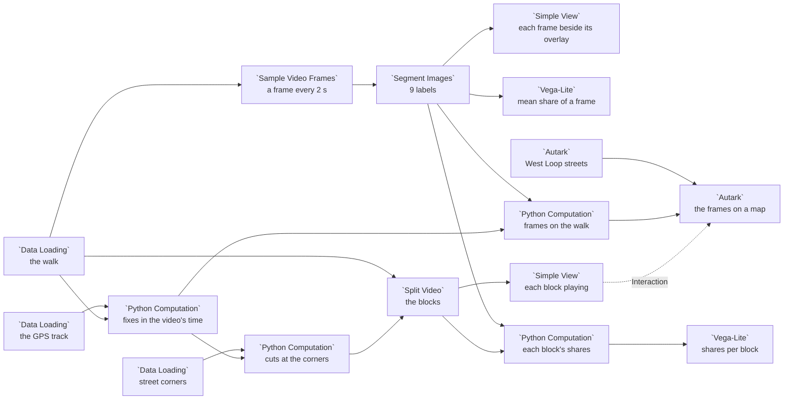

# Example: SideSeeing: frames, segments and blocks

A walk along the sidewalks of Chicago's West Loop on 2026-10-26, recorded with
the SideSeeing app on a phone looking down at the sidewalk: 14 minutes of video,
with faces and license plates blurred, and its GPS track. Both stay in the
SideSeeing bucket on data.urbantk.org and are read in place.

This example samples a frame every 2 seconds, finds in each frame what 9 labels
name with SAM 3, places the frames on the walk on a map, and cuts the walk into
blocks at the street corners it passes, each block with its share of frames
showing each label.

Segment Images runs SAM 3, whose 3.4 GB of weights download the first time a
node needs them. It is practical on a GPU: on one, the walk's 433 frames take
about 3 minutes.

## Pipeline overview



## The walk and its GPS track

The walk is a collection of one video, `data.sideseeing.west-loop-walk`:

```python
collection = curio_load_collection("data.sideseeing.west-loop-walk")

return collection
```

Its GPS track, `data.sideseeing.west-loop-walk-gps`, is the walk's `gps.csv`,
1,292 fixes. A Python Computation node reads the file from its row's `path` and
gives each fix its time in the video, `t_s`, so the frames and the blocks, which
carry `t_s` too, can be placed on the track:

```python
import geopandas as gpd
import pandas as pd

# The walk's GPS fixes, each at its time in the video: t_s is the fix's
# datetime_utc less the walk's taken_at, both in UTC.
listing, walk = input_0, input_1
fixes = pd.read_csv(listing["path"].iloc[0])
fixes["datetime_utc"] = pd.to_datetime(fixes["datetime_utc"], utc=True)
taken_at = pd.Timestamp(walk["taken_at"].iloc[0])
taken_at = taken_at.tz_localize("UTC") if taken_at.tzinfo is None else taken_at.tz_convert("UTC")
fixes["t_s"] = (fixes["datetime_utc"] - taken_at).dt.total_seconds()
return gpd.GeoDataFrame(
    fixes, geometry=gpd.points_from_xy(fixes["longitude"], fixes["latitude"]), crs=4326,
)
```

## Frames, and what SAM 3 finds in them

**Sample Video Frames** samples a frame every 2 seconds over the whole walk:
`EVERY_SECONDS` is 2.0 and `MAX_FRAMES_PER_VIDEO` 450, which takes the walk's
433 frames.

**Segment Images** finds what each of 9 labels names in each frame: the ways a
curb meets the street (curb cut, curb ramp, wheelchair ramp), what marks a
crossing underfoot (tactile paving), and what stands in a walker's way. Its code
is its settings and one call of its package's function:

```python
from sam3_images import find_in_images

# What to look for, in plain words: SAM 3 takes any short noun phrase. These are
# the 9 labels the SideSeeing walk example tracks: the ways a curb meets the
# street, what marks a crossing underfoot, and what stands in a walker's way.
LABELS = [
    "curb cut", "curb ramp", "wheelchair ramp", "tactile paving",
    "pole", "bollard", "construction barrier", "traffic cone", "person",
]
THRESHOLD = 0.5  # the score SAM 3 needs to keep an object
WIDTH = 960  # the widest images are read and drawn at
MAX_IMAGES = 450  # the most images one run looks at

return find_in_images(
    input_0, curio_load_model("model.curio.sam3"), curio_derived_file,
    labels=LABELS, threshold=THRESHOLD, width=WIDTH, max_images=MAX_IMAGES,
)
```

Each frame comes back with the label covering the most of it, each label's
share of the frame and count of objects, and an overlay of the frame with each
object drawn. **Simple View** shows each frame beside its overlay, and a
**Vega-Lite** chart the mean share of a frame each label covers:

```json
{
  "$schema": "https://vega.github.io/schema/vega-lite/v6.json",
  "description": "The mean share of a frame each label covers, over the walk's frames.",
  "title": "Mean share of a frame (%)",
  "transform": [
    {
      "fold": [
        "curb cut_pct",
        "curb ramp_pct",
        "wheelchair ramp_pct",
        "tactile paving_pct",
        "pole_pct",
        "bollard_pct",
        "construction barrier_pct",
        "traffic cone_pct",
        "person_pct"
      ],
      "as": [
        "column",
        "share"
      ]
    },
    {
      "calculate": "replace(datum.column, '_pct', '')",
      "as": "label"
    },
    {
      "aggregate": [
        {
          "op": "mean",
          "field": "share",
          "as": "mean_share"
        }
      ],
      "groupby": [
        "label"
      ]
    }
  ],
  "mark": "bar",
  "encoding": {
    "y": {
      "field": "label",
      "type": "nominal",
      "sort": "-x",
      "title": null
    },
    "x": {
      "field": "mean_share",
      "type": "quantitative",
      "title": "Mean share of a frame (%)"
    }
  }
}
```

## The frames on the walk

Each frame is placed where the GPS track was at its `t_s`, between the fixes
before and after it:

```python
import geopandas as gpd
import numpy as np

# Each frame placed on the walk where the GPS track was at its t_s, between the
# fixes before and after it, with the share of the frame each label covers.
frames, fixes = input_0, input_1.sort_values("t_s")
shares = [column for column in frames.columns if column.endswith("_pct")]
placed = frames[["t_s", "dominant_class", *shares]].rename(columns=lambda column: column.replace(" ", "_"))
lon = np.interp(frames["t_s"], fixes["t_s"], fixes["longitude"])
lat = np.interp(frames["t_s"], fixes["t_s"], fixes["latitude"])
return gpd.GeoDataFrame(placed, geometry=gpd.points_from_xy(lon, lat), crs=4326)
```

An **Autark** node loads the West Loop's streets and buildings from an
OpenStreetMap extract, and the map draws the frames over them, colored by how
much of each frame a curb cut covers:

```json
{
  "map": {
    "layerRefs": [
      {
        "dataRef": "[!! input_1:table_osm_surface !!]"
      },
      {
        "dataRef": "[!! input_1:table_osm_roads !!]"
      },
      {
        "dataRef": "[!! input_1:table_osm_buildings !!]"
      },
      {
        "dataRef": "[!! input_0 !!]",
        "getFnv": "curb_cut_pct",
        "getFnvType": "quantitative",
        "defaultFnv": 0,
        "isPick": true,
        "isColorMap": true,
        "title": "Curb cut (% of the frame)"
      }
    ]
  }
}
```

## The walk cut into blocks

`data.sideseeing.west-loop-corners` holds the corners of the West Loop's named
streets: where two named streets meet, and their names. The walk is cut where
it first passes within 12 m of a corner. A block runs along the street its
corner shares with the next corner, from one cross street to the next:

```python
import geopandas as gpd
import pandas as pd

# Where the walk is cut into blocks: the first time a GPS fix comes within 12 m
# of a corner of two named streets. A block runs along the street its corner
# shares with the next corner the walk passes, from its corner's other street
# to the next one's.
fixes, corners = input_0, input_1
near = gpd.sjoin_nearest(fixes.to_crs(26916), corners.to_crs(26916), max_distance=12)
passed = near.groupby(["street_a", "street_b"], as_index=False)["t_s"].min().sort_values("t_s")
passed = passed.to_dict("records")
cuts, street = [], None
for here, there in zip(passed, passed[1:] + [None]):
    names = {here["street_a"], here["street_b"]}
    if there is not None:
        shared = names & {there["street_a"], there["street_b"]}
        street = min(shared) if shared else None
        to = ", ".join(sorted({there["street_a"], there["street_b"]} - {street}))
    else:
        street = street if street in names else None
        to = "the walk's end"
    cuts.append({"street": street, "from": ", ".join(sorted(names - {street})), "to": to, "t_s": round(here["t_s"], 3)})
return pd.DataFrame(cuts)
```

**Split Video** cuts the walk at those times into blocks, each a video of its
own. On this walk that is five blocks of South Racine Avenue, from West Madison
Street to West Van Buren Street and on to the walk's end. **Simple View** plays
each block, its card captioned with the block, its street and its cross
streets. An interaction edge from that Simple View to the map lights the frames
up to where the block plays, since each block keeps `t_s`, where it starts in
the walk's video.

## Each block's share of frames

For each block, the share of its frames that show each label: how often a curb
cut or a pole is in view along the block.

```python
import pandas as pd

# Each block's share of frames showing each label: of the frames whose t_s
# falls within the block, the share with at least one object of the label.
frames, blocks = input_0, input_1
labels = [column[: -len("_pct")] for column in frames.columns if column.endswith("_pct") and column != "dominant_pct"]
rows = []
for block in blocks.to_dict("records"):
    inside = frames[(frames["t_s"] >= block["t_s"]) & (frames["t_s"] < block["end_s"])]
    for label in labels:
        seen = inside[label.replace(" ", "_") + "_objects"] > 0
        rows.append({
            "block": int(block["block"]), "street": block["street"], "from": block["from"], "to": block["to"],
            "label": label, "share": round(float(seen.mean() * 100), 1) if len(inside) else 0.0,
            "frames": int(len(inside)),
        })
return pd.DataFrame(rows)
```

```json
{
  "$schema": "https://vega.github.io/schema/vega-lite/v6.json",
  "description": "Each block's share of frames showing each label, side by side.",
  "title": "Frames showing each label, per block (%)",
  "mark": "bar",
  "encoding": {
    "x": {
      "field": "block",
      "type": "ordinal",
      "title": "Block"
    },
    "xOffset": {
      "field": "label"
    },
    "y": {
      "field": "share",
      "type": "quantitative",
      "title": "Share of the block's frames (%)"
    },
    "color": {
      "field": "label",
      "type": "nominal",
      "title": "Label"
    },
    "tooltip": [
      {
        "field": "block"
      },
      {
        "field": "street"
      },
      {
        "field": "from"
      },
      {
        "field": "to"
      },
      {
        "field": "label"
      },
      {
        "field": "share"
      },
      {
        "field": "frames"
      }
    ]
  }
}
```
