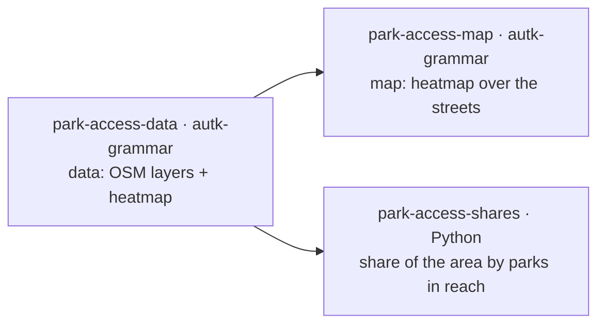

# Example: Park access as an Autark heatmap

How close is every part of Lower Manhattan's tip to a park? One `autk-grammar` node loads the tip's
streets, parks and water from a local `.pbf` file and bins the parks into a heatmap: each cell of a
30 by 30 grid counts the parks within about 150 m of its center, measured to the nearest edge of each
park. A second `autk-grammar` node draws the heatmap over the streets, parks and water, and a
`Python Computation` node reads it as a `rasterio` dataset and gives the share of the area by how many
parks are within reach. The extract is a local file, so no Overpass call is made at run time.

> [!NOTE]
> **WebGPU required**
> Autark relies on WebGPU. Run this example in a Chromium-based browser (Chrome / Edge) on a machine
> with a working GPU stack.

## Pipeline overview



The data node has only a `data` block, so it hands its tables on: the four layers of the extract,
then the heatmap, a raster. The map node draws them by their table names, and the Python node gets
the layers and the heatmap in its `input_0`.

## Data

`docs/examples/data/lower_mnt.osm.pbf` is an OpenStreetMap extract for Lower Manhattan (© OpenStreetMap
contributors, ODbL 1.0), built by `scripts/build_example_pbfs.py`. The example reads the box from
longitude -74.0195 to -74.0085 and latitude 40.7 to 40.7085: Battery Park, the Battery Park City
esplanade and the south end of the Financial District, where small plazas and gardens sit between
the streets, so the parks within reach change from one cell to the next.

## Step 1: Load the layers and build the heatmap (`park-access-data`)

The `osm` source loads the box's surface, parks, water and roads into the tables `tip_surface`,
`tip_parks`, `tip_water` and `tip_roads`. The `heatmap` source then bins `tip_parks` into a grid of 30
rows and 30 columns over the area the document loads:

- `near.distance` is 200 in the map's planar units (EPSG:3395), about 150 m on the ground here;
- `"useCentroid": false` measures to the nearest point of each park's shape, its edge, rather than to
  its center, so a large park counts in every cell near any of its sides;
- the one `groupBy` entry, `count`, makes one band, `count_tip_parks`: the number of parks within reach
  of the cell's center, 0 where there is none.

```json
"data": [
  {
    "type": "osm", "pbfFileUrl": "docs/examples/data/lower_mnt.osm.pbf",
    "queryArea": { "bbox": [-74.0195, 40.7, -74.0085, 40.7085] },
    "outputTableName": "tip",
    "autoLoadLayers": { "layers": ["surface", "parks", "water", "roads"] }
  },
  {
    "type": "heatmap", "joinDataRef": "tip_parks", "outputTableName": "park_access",
    "near": { "distance": 200, "useCentroid": false },
    "grid": { "rows": 30, "columns": 30 },
    "groupBy": [{ "column": "*", "aggregateFn": "count" }]
  }
]
```

## Step 2: The heatmap on a map (`park-access-map`)

The map draws the layers the data node hands on, by their table names, with the heatmap last. Its
`getFnv`, `count.tip_parks`, names the band by its aggregate and table, and `opacity` lets the streets
show through the cells.

```json
"map": { "layerRefs": [
  { "dataRef": "tip_surface" },
  { "dataRef": "tip_parks" },
  { "dataRef": "tip_water" },
  { "dataRef": "tip_roads" },
  { "dataRef": "park_access", "getFnv": "count.tip_parks", "title": "Parks within about 150 m", "opacity": 0.6 }
] }
```

## Step 3: The share of the area by parks within reach (`park-access-shares`)

The Python node finds the heatmap among its inputs, a `rasterio` dataset whose band is described by
its label, reads that band, and gives the share of the 900 cells, and so of the area, that reach none,
1, 2 to 4, 5 to 9, or 10 or more parks.

```python
import pandas as pd
import rasterio

# The heatmap the data node built, a rasterio dataset on its 30 by 30 grid, and
# its band that counts the parks within about 150 m of each cell's center.
heat = next(item for item in input_0 if isinstance(item, rasterio.io.DatasetReader))
parks = pd.Series(heat.read(heat.descriptions.index("count_tip_parks") + 1).ravel())

# The share of the area each number of parks within reach covers.
reach = pd.cut(parks, [-0.5, 0.5, 1.5, 4.5, 9.5, float("inf")],
               labels=["none", "1", "2 to 4", "5 to 9", "10 or more"])
share = reach.value_counts(normalize=True, sort=False)
return pd.DataFrame({
    "parks within about 150 m": share.index.astype(str),
    "share of the area": share.values.round(3),
})
```

## What you see

The map shows the tip of Manhattan under a grid of cells colored by how many parks are within about
150 m, from none to dozens around Battery Park and the Financial District's plazas and gardens, with
the streets showing through. The legend reads the band's range, and the table gives the share of the
area each number of parks within reach covers.
