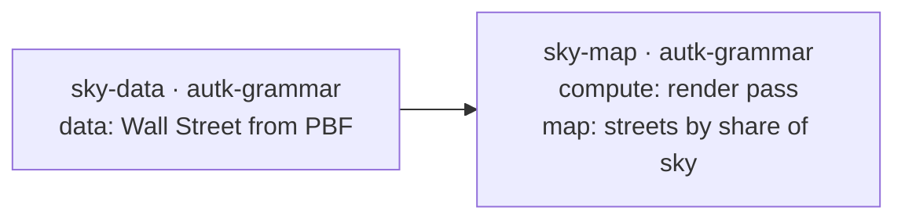

# Example: Sky seen from the street with an Autark render pass

How much sky does each street around Wall Street see between its buildings? A render pass answers it on the
GPU: from each street, Autark draws the buildings in four directions, looking up at 45 degrees, and counts
how much of each frame is sky. The first `autk-grammar` node loads the surface, roads and buildings from a
local `.pbf` file; the second runs the render pass, which writes the streets as a new table with their share
of sky, and maps it over the buildings.

> [!NOTE]
> **WebGPU required**
> Autark relies on WebGPU. Run this example in a Chromium-based browser (Chrome / Edge) on a machine
> with a working GPU stack.

## Pipeline overview



The loader is a grammar node with only a `data` block, so it hands its tables on as a layer array. The map
node reads them by name (`wall_st_surface`, `wall_st_roads`, `wall_st_buildings`), and its render pass
writes a table of its own, `street_sky`, which its `map` block draws.

## Data

`docs/examples/data/lower_mnt.osm.pbf` is an OpenStreetMap extract for Lower Manhattan (© OpenStreetMap
contributors, ODbL 1.0), built by `scripts/build_example_pbfs.py`.

## Step 1: Load Wall Street from a PBF (`sky-data`)

The `data` block loads the box around Wall Street, west, south, east and north, from the extract: its
surface, its roads and its buildings, each with its height.

```json
"data": [{
  "type": "osm",
  "pbfFileUrl": "docs/examples/data/lower_mnt.osm.pbf",
  "queryArea": { "bbox": [-74.0125, 40.705, -74.008, 40.7085] },
  "outputTableName": "wall_st",
  "autoLoadLayers": { "layers": ["surface", "roads", "buildings"] }
}]
```

## Step 2: The render pass (`sky-map`)

The pass draws the buildings, raised to their heights, from each road of `wall_st_roads`: from the middle of
the road, on the ground, in four directions around it, each looking up at 45 degrees, into frames 64 pixels
square. It counts the share of each road's frames the buildings cover and, with `includeBackground`, the
share no layer covers, named `sky`.

```json
"compute": [{
  "type": "render",
  "outputTableName": "street_sky",
  "layers": [{ "id": "buildings", "dataRef": "wall_st_buildings", "type": "buildings" }],
  "viewpoints": { "dataRef": "wall_st_roads", "sampling": { "directions": 4, "pitchDeg": 45 } },
  "aggregation": { "type": "classes", "includeBackground": true, "backgroundLayerType": "sky" },
  "tileSize": 64
}]
```

The pass writes `street_sky`: the roads, each with its shares in `compute.render.classes`, such as
`{"buildings": 0.3, "sky": 0.7}`, which add up to 1. `wall_st_roads` stays as it was.

## Step 3: Map the share of sky (`sky-map`)

The map draws the surface and the buildings, and over them `street_sky`, each road colored by its share of
sky on a blue scale: pale where the buildings close in, darker where the road sees more sky.

```json
"map": { "layerRefs": [
  { "dataRef": "wall_st_surface" },
  { "dataRef": "wall_st_buildings" },
  { "dataRef": "street_sky", "title": "Share of sky seen from the street",
    "getFnv": "compute.render.classes.sky", "getFnvType": "quantitative",
    "colorMapInterpolator": "interpolateBlues" }
]}
```

## Final result

A WebGPU map of the streets around Wall Street, each colored by the share of sky it sees between the
buildings: narrow streets between tall buildings see little of it, and the wider ones more. A
[render pass](../USAGE.md#render-passes) can also count each building's share of the frames, with
`"aggregation": {"type": "objects"}`, or look out from each building's windows, with the
`building-windows` strategy.
