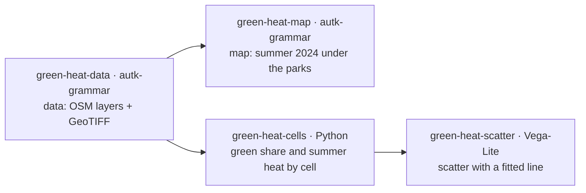

# Example: Green share and summer heat in Niterói

Are the greener parts of Niterói cooler in summer? One `autk-grammar` node loads the city's surface,
parks and roads from a local `.pbf` file and its summer land surface temperature from a GeoTIFF with a
`geotiff` source. A second `autk-grammar` node draws the summer of 2024 under the parks and roads. A
`Python Computation` node gives each cell of the temperature's grid, about 1 km across, whose center is
on land the share of its area that is green, from the outlines of the parks layer, beside its mean
summer temperature from 2020 to 2024, and a Vega-Lite scatter plots one against the other with a fitted
line. Both files are in the repository, so nothing is fetched at run time.

> [!NOTE]
> **WebGPU required**
> Autark relies on WebGPU. Run this example in a Chromium-based browser (Chrome / Edge) on a machine
> with a working GPU stack.

## Pipeline overview



The data node has only a `data` block, so it hands its tables on: the three layers of the extract, then
the GeoTIFF, a raster. The map node draws them by their table names, and the Python node gets the layers
and the raster in its `input_0`, the raster a `rasterio` dataset.

## Data

`docs/examples/data/niteroi.osm.pbf` is an OpenStreetMap extract for Niterói (© OpenStreetMap contributors,
ODbL 1.0), built by `scripts/build_example_pbfs.py`. `docs/examples/data/niteroi_lst_verao_2001_2024.tif`
is the 24-band land surface temperature raster example 08 uses, from the upstream Autark repo: one band for
each summer from 2001 to 2024, the mean daytime land surface temperature of its December, January and
February from MODIS (MOD11A2), in °C, on 22 by 15 cells of about 1 km over Niterói.

## Step 1: Load the layers and the GeoTIFF (`green-heat-data`)

The `osm` source loads Niterói's land (its surface), parks and roads into the tables `table_osm_surface`,
`table_osm_parks` and `table_osm_roads`, from example 08's extract and area. The parks layer holds what autk-db takes as
green: parks, playgrounds, recreation grounds and dog parks; woods, forests, grass, meadows, orchards,
vineyards, cemeteries and village greens; grassland, scrub and heath. The `geotiff` source loads the
temperature raster into the table `lst`, its bands named `band_1` to `band_24`; `"resampleMethod":
"nearest"` keeps each cell's own value should the file need shrinking as it loads.

```json
"data": [
  {
    "type": "osm", "pbfFileUrl": "docs/examples/data/niteroi.osm.pbf",
    "queryArea": { "geocodeArea": "Rio de Janeiro", "areas": ["Niterói"] },
    "outputTableName": "table_osm",
    "autoLoadLayers": { "layers": ["surface", "parks", "roads"] }
  },
  {
    "type": "geotiff", "geotiffFileUrl": "docs/examples/data/niteroi_lst_verao_2001_2024.tif",
    "outputTableName": "lst", "resampleMethod": "nearest"
  }
]
```

## Step 2: The summer of 2024 on a map (`green-heat-map`)

The map draws the temperature raster by its last band, `band_24`, the summer of 2024, in yellows to reds,
with the parks over it in a see-through green and the roads on top.

```json
"map": { "layerRefs": [
  { "dataRef": "lst", "getFnv": "band_24", "colorMapInterpolator": "interpolateYlOrRd",
    "title": "Summer surface temperature, 2024 (°C)" },
  { "dataRef": "table_osm_parks", "color": "#2ca02c", "opacity": 0.45, "title": "Parks" },
  { "dataRef": "table_osm_roads", "color": "#4d4d4d", "title": "Roads" }
] }
```

## Step 3: Green share and summer heat by cell (`green-heat-cells`)

The Python node finds the temperature among its inputs, a `rasterio` dataset, and the parks and the land
among the layers by their tables' names, all in EPSG:3395. It joins the parks' outlines into one shape,
so ground that two of them cover counts once, averages the summers of 2020 to 2024, and keeps the cells
whose center lies on Niterói's land, each with its row and column on the temperature's grid and the share
of its square that the green shape covers, from 0 to 1.

```python
import pandas as pd
import rasterio
from shapely.geometry import Point, box, shape
from shapely.ops import unary_union
from shapely.prepared import prep
from shapely.validation import make_valid

# The data node hands on its OpenStreetMap layers, then the land surface
# temperature, a rasterio dataset in EPSG:3395 with one band a summer from 2001
# to 2024. The layers are in EPSG:3395 too.
lst = next(item for item in input_0 if isinstance(item, rasterio.io.DatasetReader))
features = {item["name"]: item["geojson"]["features"] for item in input_0 if isinstance(item, dict)}

# All the green the parks layer holds, parks, woods, grass, scrub and the
# rest, as one shape, and Niterói's land.
green = unary_union([make_valid(shape(feature["geometry"])) for feature in features["table_osm_parks"]])
on_land = prep(unary_union([make_valid(shape(feature["geometry"])) for feature in features["table_osm_surface"]]))
# Each cell's mean summer surface temperature over the last five summers.
summer = lst.read([20, 21, 22, 23, 24]).mean(axis=0)

# The cells whose center lies on Niterói's land, each with the share of its
# area that is green.
cells = []
for row in range(lst.height):
    for col in range(lst.width):
        if not on_land.contains(Point(lst.xy(row, col))):
            continue
        (west, north), (east, south) = lst.xy(row, col, offset="ul"), lst.xy(row, col, offset="lr")
        cell = box(west, south, east, north)
        cells.append({
            "row": row,
            "column": col,
            "green share": round(green.intersection(cell).area / cell.area, 3),
            "summer temperature, 2020 to 2024 (°C)": round(float(summer[row, col]), 2),
        })
return pd.DataFrame(cells)
```

## Step 4: The scatter and its fitted line (`green-heat-scatter`)

A Vega-Lite chart draws one point a cell, its green share across and its mean summer temperature up, and
a second layer fits a straight line through them with Vega-Lite's `regression` transform.

```json
"layer": [
  { "mark": { "type": "point", "filled": true, "opacity": 0.6 },
    "encoding": {
      "x": { "field": "green share", "type": "quantitative" },
      "y": { "field": "summer temperature, 2020 to 2024 (°C)", "type": "quantitative", "scale": { "zero": false } } } },
  { "mark": { "type": "line", "color": "#d62728", "strokeWidth": 2 },
    "transform": [{ "regression": "summer temperature, 2020 to 2024 (°C)", "on": "green share" }],
    "encoding": {
      "x": { "field": "green share", "type": "quantitative" },
      "y": { "field": "summer temperature, 2020 to 2024 (°C)", "type": "quantitative" } } }
]
```

## What you see

The map shows Niterói under its summer of 2024, cell by cell, with its parks and roads over it; the legend
reads the band's range in °C. The scatter puts each cell on land at its green share and its mean summer
temperature from 2020 to 2024. The red line's slope is the answer: the difference between an all-green
cell and a bare one, in °C. A line that falls from left to right says the greener cells are cooler.
