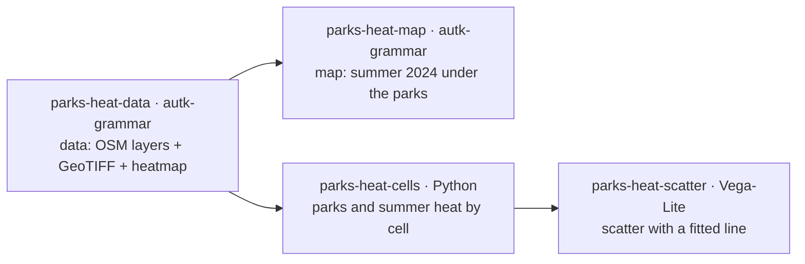

# Example: Parks and summer heat in Niterói

Are the parts of Niterói near parks cooler in summer? One `autk-grammar` node loads the city's surface,
parks, water and roads from a local `.pbf` file, its summer land surface temperature from a GeoTIFF with a
`geotiff` source, and bins the parks into a heatmap: each cell of a 60 by 80 grid counts the parks within
about 500 m of its center, measured to the nearest edge of each park. A second `autk-grammar` node draws
the summer of 2024 under the parks and roads. A `Python Computation` node puts the park counts on the
temperature's grid of cells about 1 km across and gives each cell on land its mean summer temperature from
2020 to 2024, and a Vega-Lite scatter plots one against the other with a fitted line. Both files are in the
repository, so nothing is fetched at run time.

> [!NOTE]
> **WebGPU required**
> Autark relies on WebGPU. Run this example in a Chromium-based browser (Chrome / Edge) on a machine
> with a working GPU stack.

## Pipeline overview



The data node has only a `data` block, so it hands its tables on: the four layers of the extract, then
the GeoTIFF and the heatmap, two rasters. The map node draws them by their table names, and the Python
node gets the layers and both rasters in its `input_0`, each raster a `rasterio` dataset.

## Data

`docs/examples/data/niteroi.osm.pbf` is an OpenStreetMap extract for Niterói (© OpenStreetMap contributors,
ODbL 1.0), built by `scripts/build_example_pbfs.py`. `docs/examples/data/niteroi_lst_verao_2001_2024.tif`
is the 24-band land surface temperature raster example 08 uses, from the upstream Autark repo: one band for
each summer from 2001 to 2024, the mean daytime land surface temperature of its December, January and
February from MODIS (MOD11A2), in °C, on 22 by 15 cells of about 1 km over Niterói.

## Step 1: Load the layers, the GeoTIFF and the heatmap (`parks-heat-data`)

The `osm` source loads Niterói's land (its surface), parks, water and roads into the tables
`table_osm_surface`, `table_osm_parks`, `table_osm_water` and `table_osm_roads`, as example 08 does. The
`geotiff` source loads the temperature raster into the table `lst`, its bands named `band_1` to `band_24`;
`"resampleMethod": "nearest"` keeps each cell's own value should the file need shrinking as it loads. The
`heatmap` source then bins `table_osm_parks` into a grid of 60 rows and 80 columns over the area the
document loads:

- `near.distance` is 543 in the map's planar units (EPSG:3395), about 500 m on the ground at Niterói's
  latitude;
- `"useCentroid": false` measures to the nearest point of each park's shape, its edge, rather than to its
  center, so a large park counts in every cell near any of its sides;
- the one `groupBy` entry, `count`, makes one band, `count_table_osm_parks`: the number of parks within
  reach of the cell's center, 0 where there is none.

```json
"data": [
  {
    "type": "osm", "pbfFileUrl": "docs/examples/data/niteroi.osm.pbf",
    "queryArea": { "geocodeArea": "Rio de Janeiro", "areas": ["Niterói"] },
    "outputTableName": "table_osm",
    "autoLoadLayers": { "layers": ["surface", "parks", "water", "roads"] }
  },
  {
    "type": "geotiff", "geotiffFileUrl": "docs/examples/data/niteroi_lst_verao_2001_2024.tif",
    "outputTableName": "lst", "resampleMethod": "nearest"
  },
  {
    "type": "heatmap", "joinDataRef": "table_osm_parks", "outputTableName": "park_access",
    "near": { "distance": 543, "useCentroid": false },
    "grid": { "rows": 60, "columns": 80 },
    "groupBy": [{ "column": "*", "aggregateFn": "count" }]
  }
]
```

## Step 2: The summer of 2024 on a map (`parks-heat-map`)

The map draws the temperature raster by its last band, `band_24`, the summer of 2024, in yellows to reds,
with the parks over it in a see-through green and the roads on top.

```json
"map": { "layerRefs": [
  { "dataRef": "lst", "getFnv": "band_24", "colorMapInterpolator": "interpolateYlOrRd",
    "title": "Summer surface temperature, 2024 (°C)" },
  { "dataRef": "table_osm_parks", "color": "#2ca02c", "opacity": 0.45, "title": "Parks" },
  { "dataRef": "table_osm_roads", "color": "#4d4d4d", "title": "Roads" }
] }
```

## Step 3: Parks and summer heat by cell (`parks-heat-cells`)

The Python node finds the two rasters among its inputs by their bands' descriptions, the temperature by
`band_24` and the heatmap by `count_table_osm_parks`, and the land among the layers by its table's name.
It resamples the heatmap's counts onto the temperature's grid with `rasterio`, each cell of about 1 km
taking the mean of the heatmap's cells that fall in it, averages the summers of 2020 to 2024, and keeps
the cells whose center lies on Niterói's land, each with its row and column on the temperature's grid.

```python
import numpy as np
import pandas as pd
import rasterio
from rasterio.warp import Resampling, reproject
from shapely.geometry import Point, shape
from shapely.ops import unary_union
from shapely.prepared import prep

# The data node hands on its OpenStreetMap layers, then two rasterio datasets,
# each on its own grid in EPSG:3395: the land surface temperature, one band a
# summer from 2001 to 2024, and the heatmap of the parks within about 500 m.
rasters = [item for item in input_0 if isinstance(item, rasterio.io.DatasetReader)]
lst = next(raster for raster in rasters if "band_24" in raster.descriptions)
heat = next(raster for raster in rasters if "count_table_osm_parks" in raster.descriptions)
land = next(item for item in input_0 if isinstance(item, dict) and item["name"] == "table_osm_surface")

# The park count on the temperature grid: in each cell of about 1 km, the mean
# of the heatmap's cells that fall in it.
parks = np.full((lst.height, lst.width), np.nan, dtype="float32")
reproject(
    heat.read(heat.descriptions.index("count_table_osm_parks") + 1), parks,
    src_transform=heat.transform, src_crs=heat.crs, src_nodata=np.nan,
    dst_transform=lst.transform, dst_crs=lst.crs, dst_nodata=np.nan,
    resampling=Resampling.average,
)
# Each cell's mean summer surface temperature over the last five summers.
summer = lst.read([20, 21, 22, 23, 24]).mean(axis=0)

# The cells whose center lies on Niterói's land, each with both values.
on_land = prep(unary_union([shape(feature["geometry"]) for feature in land["geojson"]["features"]]))
return pd.DataFrame([
    {
        "row": row,
        "column": col,
        "parks within about 500 m": round(float(parks[row, col]), 2),
        "summer temperature, 2020 to 2024 (°C)": round(float(summer[row, col]), 2),
    }
    for row in range(lst.height) for col in range(lst.width)
    if not np.isnan(parks[row, col]) and on_land.contains(Point(lst.xy(row, col)))
])
```

## Step 4: The scatter and its fitted line (`parks-heat-scatter`)

A Vega-Lite chart draws one point a cell, its parks within reach across and its mean summer temperature up,
and a second layer fits a straight line through them with Vega-Lite's `regression` transform.

```json
"layer": [
  { "mark": { "type": "point", "filled": true, "opacity": 0.6 },
    "encoding": {
      "x": { "field": "parks within about 500 m", "type": "quantitative" },
      "y": { "field": "summer temperature, 2020 to 2024 (°C)", "type": "quantitative", "scale": { "zero": false } } } },
  { "mark": { "type": "line", "color": "#d62728", "strokeWidth": 2 },
    "transform": [{ "regression": "summer temperature, 2020 to 2024 (°C)", "on": "parks within about 500 m" }],
    "encoding": {
      "x": { "field": "parks within about 500 m", "type": "quantitative" },
      "y": { "field": "summer temperature, 2020 to 2024 (°C)", "type": "quantitative" } } }
]
```

## What you see

The map shows Niterói under its summer of 2024, cell by cell, with its parks and roads over it; the legend
reads the band's range in °C. The scatter puts each cell on land at its number of parks within about 500 m
and its mean summer temperature from 2020 to 2024. The red line's slope is the answer: a line that falls
from left to right says the cells with more parks within reach are cooler, and a flat one says the number
of parks within reach does not tell a cool cell from a hot one.
