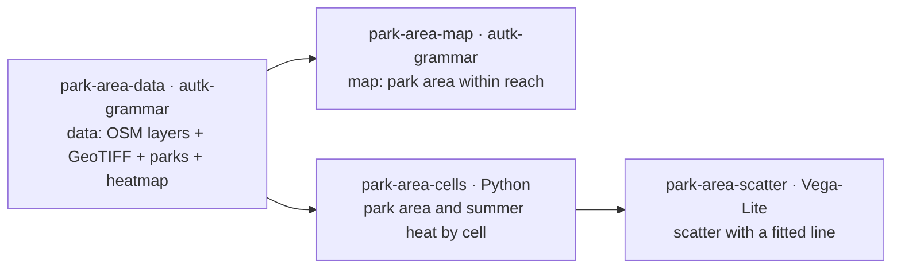

# Example: Park area within reach and summer heat in Niterói

Are the parts of Niterói with more park nearby cooler in summer? One `autk-grammar` node loads the city's
surface and roads from a local `.pbf` file, its summer land surface temperature from a GeoTIFF with a
`geotiff` source, and its parks, each with its area, from a GeoJSON file, and sums those areas into a
heatmap: each cell of a 60 by 80 grid holds the area of the parks within about 500 m of its center,
measured to the nearest edge of each park. A second `autk-grammar` node draws the heatmap under the parks
and roads. A `Python Computation` node puts the heatmap on the temperature's grid of cells about 1 km
across and gives each cell on land its park area within reach beside its mean summer temperature from
2020 to 2024, and a Vega-Lite scatter plots one against the other with a fitted line. All three files are
in the repository, so nothing is fetched at run time.

> [!NOTE]
> **WebGPU required**
> Autark relies on WebGPU. Run this example in a Chromium-based browser (Chrome / Edge) on a machine
> with a working GPU stack.

## Pipeline overview



The data node has only a `data` block, so it hands its tables on: the two layers of the extract and the
parks, then the GeoTIFF and the heatmap, two rasters. The map node draws them by their table names, and
the Python node gets the layers and both rasters in its `input_0`, each raster a `rasterio` dataset.

## Data

`docs/examples/data/niteroi.osm.pbf` is an OpenStreetMap extract for Niterói (© OpenStreetMap contributors,
ODbL 1.0), built by `scripts/build_example_pbfs.py`. `docs/examples/data/niteroi_lst_verao_2001_2024.tif`
is the 24-band land surface temperature raster example 08 uses, from the upstream Autark repo: one band for
each summer from 2001 to 2024, the mean daytime land surface temperature of its December, January and
February from MODIS (MOD11A2), in °C, on 22 by 15 cells of about 1 km over Niterói.

`docs/examples/data/niteroi_parks.geojson` holds the parks of that extract (© OpenStreetMap contributors,
ODbL 1.0) that autk-db's parks layer takes: parks, playgrounds, recreation grounds and dog parks; woods,
forests, grass, meadows, orchards, vineyards, cemeteries and village greens; grassland, scrub and heath.
Each is cut to Niterói's boundary and carries its OpenStreetMap element and `area`, its area in m² in an
equal-area projection (EPSG:6933). `scripts/build_example_niteroi_parks.py` builds it from the extract,
with each outline simplified within about 5 m.

## Step 1: Load the layers, the GeoTIFF, the parks and the heatmap (`park-area-data`)

The `osm` source loads Niterói's land (its surface) and roads into the tables `table_osm_surface` and
`table_osm_roads`, from example 08's extract and area. The `geotiff` source loads the temperature raster into the table
`lst`, its bands named `band_1` to `band_24`. The `geojson` source loads the parks into the table
`park_areas`, each row with its `area`. The `heatmap` source then sums them into a grid of 60 rows and 80
columns over the area the document loads:

- `near.distance` is 543 in the map's planar units (EPSG:3395), about 500 m on the ground at Niterói's
  latitude;
- `"useCentroid": false` measures to the nearest point of each park's shape, its edge, rather than to its
  center, so a large park counts in every cell near any of its sides;
- the one `groupBy` entry, the `sum` of `area`, makes one band, `sum_park_areas`: the total area, in m²,
  of every park whose edge lies within reach of the cell's center, a large park counting whole, 0 where
  there is none. Two outlines over the same ground, such as a park and a wood inside it, each count.

```json
"data": [
  {
    "type": "osm", "pbfFileUrl": "docs/examples/data/niteroi.osm.pbf",
    "queryArea": { "geocodeArea": "Rio de Janeiro", "areas": ["Niterói"] },
    "outputTableName": "table_osm",
    "autoLoadLayers": { "layers": ["surface", "roads"] }
  },
  {
    "type": "geotiff", "geotiffFileUrl": "docs/examples/data/niteroi_lst_verao_2001_2024.tif",
    "outputTableName": "lst", "resampleMethod": "nearest"
  },
  {
    "type": "geojson", "geojsonFileUrl": "docs/examples/data/niteroi_parks.geojson",
    "outputTableName": "park_areas"
  },
  {
    "type": "heatmap", "joinDataRef": "park_areas", "outputTableName": "park_area",
    "near": { "distance": 543, "useCentroid": false },
    "grid": { "rows": 60, "columns": 80 },
    "groupBy": [{ "column": "area", "aggregateFn": "sum" }]
  }
]
```

## Step 2: The park area within reach on a map (`park-area-map`)

The map draws the heatmap first, in greens, its `getFnv`, `sum.park_areas`, naming the band by its
aggregate and table, with the parks over it in a see-through green and the roads on top.

```json
"map": { "layerRefs": [
  { "dataRef": "park_area", "getFnv": "sum.park_areas", "colorMapInterpolator": "interpolateGreens",
    "title": "Park area within about 500 m (m²)" },
  { "dataRef": "park_areas", "color": "#2ca02c", "opacity": 0.45, "title": "Parks" },
  { "dataRef": "table_osm_roads", "color": "#4d4d4d", "title": "Roads" }
] }
```

## Step 3: Park area and summer heat by cell (`park-area-cells`)

The Python node finds the two rasters among its inputs by their bands' descriptions, the temperature by
`band_24` and the heatmap by `sum_park_areas`, and the land among the layers by its table's name. It
resamples the heatmap onto the temperature's grid with `rasterio`, each cell of about 1 km taking the mean
of the heatmap's cells that fall in it, in km², averages the summers of 2020 to 2024, and keeps the cells
whose center lies on Niterói's land, each with its row and column on the temperature's grid.

```python
import numpy as np
import pandas as pd
import rasterio
from rasterio.warp import Resampling, reproject
from shapely.geometry import Point, shape
from shapely.ops import unary_union
from shapely.prepared import prep
from shapely.validation import make_valid

# The data node hands on its layers, then two rasterio datasets, each on its
# own grid in EPSG:3395: the land surface temperature, one band a summer from
# 2001 to 2024, and the heatmap of the park area within about 500 m, in m².
rasters = [item for item in input_0 if isinstance(item, rasterio.io.DatasetReader)]
lst = next(raster for raster in rasters if "band_24" in raster.descriptions)
heat = next(raster for raster in rasters if "sum_park_areas" in raster.descriptions)
land = next(item for item in input_0 if isinstance(item, dict) and item["name"] == "table_osm_surface")

# The park area on the temperature grid, in km²: in each cell of about 1 km,
# the mean of the heatmap's cells that fall in it.
area = np.full((lst.height, lst.width), np.nan, dtype="float64")
reproject(
    heat.read(heat.descriptions.index("sum_park_areas") + 1).astype("float64"), area,
    src_transform=heat.transform, src_crs=heat.crs, src_nodata=np.nan,
    dst_transform=lst.transform, dst_crs=lst.crs, dst_nodata=np.nan,
    resampling=Resampling.average,
)
area /= 1e6
# Each cell's mean summer surface temperature over the last five summers.
summer = lst.read([20, 21, 22, 23, 24]).mean(axis=0)

# The cells whose center lies on Niterói's land, each with both values.
on_land = prep(unary_union([make_valid(shape(feature["geometry"])) for feature in land["geojson"]["features"]]))
return pd.DataFrame([
    {
        "row": row,
        "column": col,
        "park area within about 500 m (km²)": round(float(area[row, col]), 3),
        "summer temperature, 2020 to 2024 (°C)": round(float(summer[row, col]), 2),
    }
    for row in range(lst.height) for col in range(lst.width)
    if not np.isnan(area[row, col]) and on_land.contains(Point(lst.xy(row, col)))
])
```

## Step 4: The scatter and its fitted line (`park-area-scatter`)

A Vega-Lite chart draws one point a cell, its park area within reach across and its mean summer
temperature up, and a second layer fits a straight line through them with Vega-Lite's `regression`
transform.

```json
"layer": [
  { "mark": { "type": "point", "filled": true, "opacity": 0.6 },
    "encoding": {
      "x": { "field": "park area within about 500 m (km²)", "type": "quantitative" },
      "y": { "field": "summer temperature, 2020 to 2024 (°C)", "type": "quantitative", "scale": { "zero": false } } } },
  { "mark": { "type": "line", "color": "#d62728", "strokeWidth": 2 },
    "transform": [{ "regression": "summer temperature, 2020 to 2024 (°C)", "on": "park area within about 500 m (km²)" }],
    "encoding": {
      "x": { "field": "park area within about 500 m (km²)", "type": "quantitative" },
      "y": { "field": "summer temperature, 2020 to 2024 (°C)", "type": "quantitative" } } }
]
```

## What you see

The map shows the park area within about 500 m over Niterói, cell by cell, under its parks and roads;
the legend reads the band's range in m². The measure is the total area of every park whose edge lies
within about 500 m of the cell's center, so a large reserve near a cell counts whole: that is why the
legend reaches about 19 million m² (19 km²), and the scatter, whose cells of about 1 km average the
heatmap's, about 16 km². The scatter puts each of the 142 cells whose center is on land at its park area
within reach and its mean summer temperature from 2020 to 2024. The red line falls from left to right,
0.157 °C for each km² of park within reach, with a correlation of -0.35 between the two.
