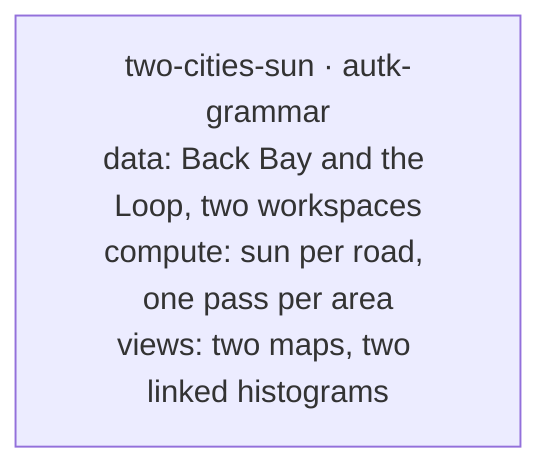

# Example: Back Bay or the Loop, whose streets get more sun at the solstice?

On June 21, do the streets of Boston's Back Bay or of the Chicago Loop get more sun? One `autk-grammar`
node loads both areas from local `.pbf` files, each into a workspace of its own, adds up each road's
minutes of sun with a WGSL shadow shader on the GPU, each area at its own latitude and longitude, and
draws four views in its body, arranged by its `layout`: a map of each area's roads colored by their
minutes of sun, side by side, and under each map a histogram of its roads' minutes of sun. Each
histogram is linked to its map's roads by `links`, so brushing bars lights those roads.

> [!NOTE]
> **WebGPU required**
> Autark relies on WebGPU. Run this example in a Chromium-based browser (Chrome / Edge) on a machine
> with a working GPU stack.

## Pipeline overview



The node has no input and hands nothing on: everything happens in its one document.

## Data

`docs/examples/data/back_bay.osm.pbf` and `docs/examples/data/chicago_loop.osm.pbf` are OpenStreetMap
extracts (© OpenStreetMap contributors, ODbL 1.0) built by `scripts/build_example_pbfs.py`, the ones
examples 06 and 07 load.

## Step 1: Each area in its workspace

Two `osm` sources load each area's surface, parks, water, roads and buildings, with the area each
example names: Back Bay into the tables `back_bay_surface`, ..., `back_bay_buildings` of the workspace
`boston`, and the Loop into `loop_surface`, ..., `loop_buildings` of the workspace `chicago`. Autark
cuts every table of a workspace to the first table's area, so the two areas, about 1,400 km apart,
each keep a workspace of their own.

```json
"data": [
  {
    "type": "osm", "pbfFileUrl": "docs/examples/data/back_bay.osm.pbf",
    "queryArea": { "geocodeArea": "Boston", "areas": ["Back Bay"] },
    "outputTableName": "back_bay", "workspace": "boston",
    "autoLoadLayers": { "layers": ["surface", "parks", "water", "roads", "buildings"] }
  },
  {
    "type": "osm", "pbfFileUrl": "docs/examples/data/chicago_loop.osm.pbf",
    "queryArea": { "geocodeArea": "Chicago", "areas": ["Loop"] },
    "outputTableName": "loop", "workspace": "chicago",
    "autoLoadLayers": { "layers": ["surface", "parks", "water", "roads", "buildings"] }
  }
]
```

## Step 2: Each road's minutes of sun

Each area has a compute pass of its own, in its workspace: example 07's shadow shader, run once per
road. For each hour from 7:00 to 19:00 of day 172 of the year, June 21, it finds the sun's altitude and
azimuth at the area's latitude and longitude, projects every building's footprint along the sun by its
height, and counts 60 minutes for the hour when no building's shadow touches the road. The Back Bay
pass writes example 06's latitude and longitude into the shader (`lat_rad = 0.7393`,
`lon_loc = -71.06`), and the Loop pass example 07's (`lat_rad = 0.73027`, `lon_loc = -87.65`). Each
pass writes its roads with their minutes of sun, from 0 to 780, as a new table of roads,
`back_bay_road_sun` and `loop_road_sun`, which the area's map and histogram read. The pass writes
each road's `sunlight` under its feature's `compute`, so the document names it `compute.sunlight`.

```json
"compute": [
  {
    "dataRef": "back_bay_roads", "workspace": "boston",
    "attributes": { "seg": "geometry.coordinates" },
    "uniforms": {
      "bld_height": { "fromFeature": { "layer": "back_bay_buildings", "iterate": "batched",
                                       "path": "properties.height", "required": true } },
      "doy": 172
    },
    "outputColumnName": "sunlight", "outputTableName": "back_bay_road_sun", "layerType": "roads"
  }
]
```

## Step 3: Four views, arranged and linked

The node draws every map and plot of its document, each in a pane of its own, maps first. Its
`layout` is a grid of two columns, 8 pixels apart, so the two maps sit side by side on the first row
and the two histograms under them:

```json
"layout": { "type": "grid", "columns": 2, "gap": 8 }
```

- Each map has an `id`, `back_bay` and `loop`, and reads its own workspace. It draws the area's
  surface, parks, water and buildings, and the pass's table of its roads colored by
  `compute.sunlight` on one range, 0 to 780 minutes, so a color means the same in both maps.
- Each histogram, `back_bay_sun` and `loop_sun`, bins the same table's roads by their minutes of sun
  into 13 bins and lets you brush them (`"events": ["brushX"]`).
- `links` joins each histogram to its own map: a link names the plot as its `source` and the map as its
  `target`, and the layer it lights is the map's layer of the plot's table, its roads with their sun.

```json
"links": [
  { "source": "back_bay_sun", "target": "back_bay" },
  { "source": "loop_sun", "target": "loop" }
]
```

The node is 1120 by 900 pixels, so each of its four panes is about 556 by 446: each map shows its whole
area, and each histogram its 13 bars with their labels.

## What you see

The two maps show each area's roads over its buildings, colored by their minutes of sun on the one range
both legends read, 0 to 780 minutes. Brushing bars of a histogram lights the roads they hold on its own
map alone, and picking a road selects its bar. Each map has its own menu, legend and R key, which
reframes the map you clicked last.
