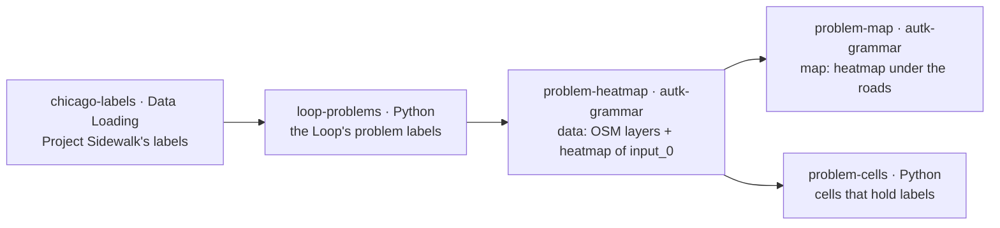

# Example: Where do sidewalk problems cluster in the Loop?

Where in Chicago's Loop do sidewalk problems pile up? A `Data Loading` node reads Project Sidewalk's
crowdsourced labels of Chicago from the Data Catalog, and a `Python Computation` node keeps the problem
labels in the Loop's box. An `autk-grammar` node loads the Loop's surface and roads from a local `.pbf`
file and bins the labels that arrive at its input into a heatmap: each cell counts the labels within
about 100 m of its center and averages their severity. A second `autk-grammar` node draws the counts
under the roads, and a `Python Computation` node reads the heatmap as a `rasterio` dataset and lists the
cells that hold labels, the most first.

> [!NOTE]
> **WebGPU required**
> Autark relies on WebGPU. Run this example in a Chromium-based browser (Chrome / Edge) on a machine
> with a working GPU stack.

## Pipeline overview



The heatmap node has only a `data` block, so it hands its tables on: the Loop's surface and roads,
then the heatmap, a raster. The labels it read from its input are not among them. The map node draws
the tables by their names, and the Python node gets the layers and the heatmap in its `input_0`.

## Data

- `data.projectsidewalk.chicago-labels`, in the Data Catalog: Project Sidewalk's 145,880 labels of
  Chicago and its suburbs, a GeoParquet of points. Each label has a type, a severity from 1 (Low) to 3
  (High), which a missing sidewalk and some other labels do not have, and `correct`, the verdict of
  Project Sidewalk's validators: 1 when more of them agreed
  with the label than disagreed, 0 when more disagreed, and empty when there is no verdict (no one
  validated it, the votes are tied, or they are all unsure). The file downloads on first use.
- `docs/examples/data/chicago_loop.osm.pbf`: an OpenStreetMap extract for the Chicago Loop
  (© OpenStreetMap contributors, ODbL 1.0), built by `scripts/build_example_pbfs.py` and cut at the
  Loop's box, from longitude -87.6382474 to -87.6024757 and latitude 41.8673 to 41.8906361.

## Step 1: Load the labels (`chicago-labels`)

The node loads the dataset by its id and keeps the columns the next steps read.

```python
labels = curio_load_data("data.projectsidewalk.chicago-labels")

return labels[["label_type", "severity", "correct", "geometry"]]
```

## Step 2: Keep the Loop's problem labels (`loop-problems`)

The step keeps the labels in the Loop's box, the box the extract is cut at, of the four types Project
Sidewalk gives a problem: `NoCurbRamp`, a missing curb ramp; `NoSidewalk`; `Obstacle`, something in
the path; and `SurfaceProblem`. Labels that mark a curb ramp, a crosswalk or a pedestrian signal are
left out, and so are the labels the validators marked wrong. A label without a verdict stays.

```python
# The Loop's box, the box its OpenStreetMap extract is cut at: west, south,
# east and north.
WEST, SOUTH, EAST, NORTH = -87.6382474, 41.8673, -87.6024757, 41.8906361
# Project Sidewalk's problem labels: a missing curb ramp, a missing sidewalk,
# an obstacle in the path and a surface problem.
PROBLEMS = ["NoCurbRamp", "NoSidewalk", "Obstacle", "SurfaceProblem"]

# The problem labels in the box, except those Project Sidewalk's validators
# marked wrong: their correct is 0, and a label without a verdict has none.
loop = input_0.cx[WEST:EAST, SOUTH:NORTH]
problems = loop[loop["label_type"].isin(PROBLEMS) & loop["correct"].ne(0)]

return problems[["label_type", "severity", "geometry"]]
```

Of the 4,310 labels in the box, 400 are problem labels, and the validators marked 118 of them wrong.
282 remain: 126 surface problems, 120 obstacles, 21 missing curb ramps and 15 missing sidewalks. 24 of
them have no severity, the 15 missing sidewalks among them.

## Step 3: Bin the labels into a heatmap (`problem-heatmap`)

The `osm` source loads the box's surface and roads into the tables `loop_surface` and `loop_roads`. As
the section's first source, it gives the node's workspace its extent, the Loop's box. The `heatmap`
source then bins `input_0`, the labels that arrive at the node's input, which the node loads into its
data section's database just before the heatmap that reads them. Its grid has 21 rows and 24 columns
over the Loop's box, cells of about 124 m on a side:

- `near.distance` is 134 in the map's planar units (EPSG:3395), about 100 m on the ground in the Loop;
- the `count` entry makes the band `count_input_0`: the labels within reach of the cell's center, 0
  where there is none;
- the `avg` entry over `severity` makes the band `avg_input_0`: the mean severity of the labels that
  have one, 0 where none of them does.

```json
"data": [
  {
    "type": "osm", "pbfFileUrl": "docs/examples/data/chicago_loop.osm.pbf",
    "queryArea": { "bbox": [-87.6382474, 41.8673, -87.6024757, 41.8906361] },
    "outputTableName": "loop",
    "autoLoadLayers": { "layers": ["surface", "roads"] }
  },
  {
    "type": "heatmap", "joinDataRef": "input_0", "outputTableName": "problems",
    "near": { "distance": 134 },
    "grid": { "rows": 21, "columns": 24 },
    "groupBy": [
      { "column": "*", "aggregateFn": "count" },
      { "column": "severity", "aggregateFn": "avg" }
    ]
  }
]
```

## Step 4: The heatmap under the roads (`problem-map`)

The map draws the heatmap by its table's name, `problems`, and its count band by its label written with
a dot, `count.input_0`, in reds that darken as the count grows. The roads come after it in the list, so
the map draws them over the cells, in dark gray.

```json
"map": { "layerRefs": [
  { "dataRef": "problems", "getFnv": "count.input_0", "colorMapInterpolator": "interpolateReds",
    "title": "Problem labels within about 100 m" },
  { "dataRef": "loop_roads", "color": "#4d4d4d", "title": "Roads" }
] }
```

## Step 5: The cells, the most first (`problem-cells`)

The Python node finds the heatmap among its inputs, a `rasterio` dataset whose bands are described by
their labels, and reads both bands. For each cell that holds labels it gives the cell's row, counted
from the north, its column, counted from the west, the longitude and latitude of its center, the labels
within about 100 m and their mean severity, the most labels first. A mean severity of 0 means none of
the cell's labels has a severity, since Project Sidewalk rates a label from 1 to 3, so the table leaves
it empty.

```python
import numpy as np
import pandas as pd
import rasterio
import rasterio.warp

# The heatmap the data node built, a rasterio dataset, and its two bands: the
# problem labels within about 100 m of each cell's center, and their mean
# severity, 0 where none of them has one. Project Sidewalk rates a label from
# 1 (Low) to 3 (High), so the table leaves a mean severity of 0 empty.
heat = next(item for item in input_0 if isinstance(item, rasterio.io.DatasetReader))
labels = heat.read(heat.descriptions.index("count_input_0") + 1)
severity = heat.read(heat.descriptions.index("avg_input_0") + 1).astype(float)
severity[severity == 0] = np.nan

# Each cell that holds labels, the most first: its row (the north row is 0),
# its column (the west column is 0) and its center's longitude and latitude.
rows, columns = np.nonzero(labels)
xs, ys = rasterio.transform.xy(heat.transform, rows, columns)
longitudes, latitudes = rasterio.warp.transform(heat.crs, "EPSG:4326", xs, ys)
cells = pd.DataFrame({
    "row": rows,
    "column": columns,
    "longitude": np.round(longitudes, 5),
    "latitude": np.round(latitudes, 5),
    "problem labels within about 100 m": labels[rows, columns].astype(int),
    "mean severity": severity[rows, columns].round(2),
})
return cells.sort_values("problem labels within about 100 m", ascending=False, kind="stable", ignore_index=True)
```

## What you see

The map shows the Loop's box under a grid of cells in reds, darker where more problem labels lie
within about 100 m, with the roads over them. Its legend runs from 0 to 33. 154 of the 504 cells hold
labels. The counts peak at 33 labels in the cell on Harrison Street between Wells Street and Wacker
Drive, at the Loop's southwest corner by the river, where the labels' mean severity is 2. The next
cells, with 19 labels each, lie on Financial Place: at Jackson Boulevard, where the mean severity is
2.58, and near Ninth Street, south of Polk Street. The table lists every cell that holds labels, the
most first, with its place and mean severity.
