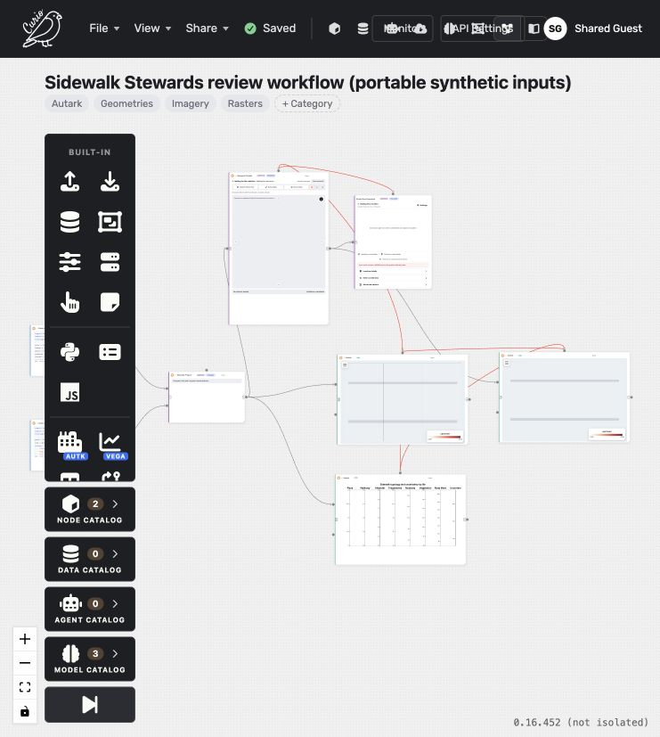
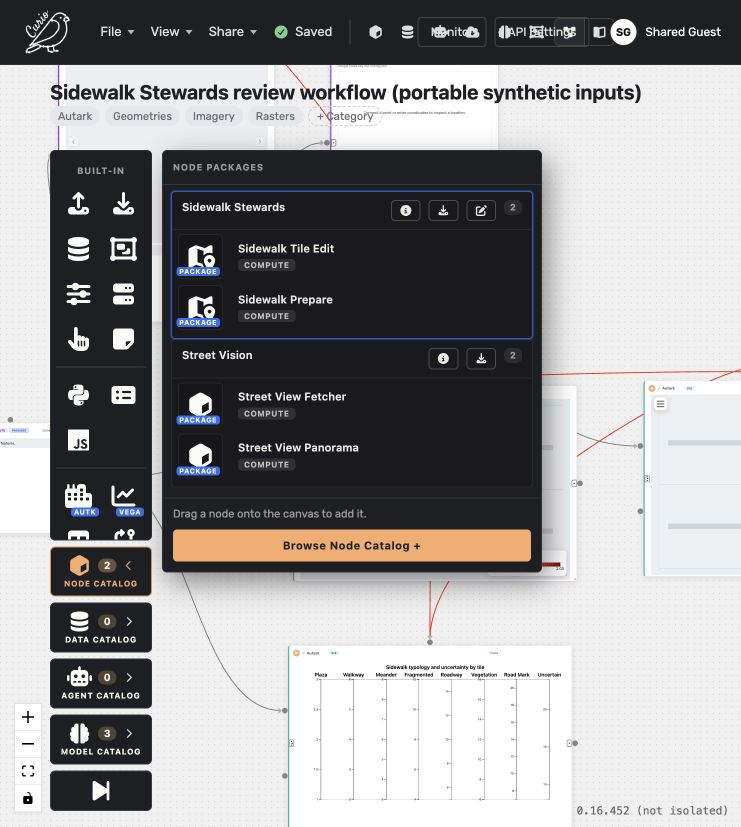

# Phase 1 PR verification — October 19, 2026

These are fresh checks of `codex/sidewalk-inspection-pr` against Curio main **6a4721c0afb0f6bca23c9c1ff55ad851eab86341 (0.16.452)**, with the renamed package and final portable examples. They supersede earlier prototype counts for this draft. No new live-provider requests were made.

## Automated checks

| Check | Fresh result |
| --- | --- |
| Focused frontend suites (command below) | **183 passed, 2 failed**, 26 suites (25 passing, 1 failing). Only the two known keyed/positional automatic map-opening gates fail |
| TypeScript `npm run typecheck` | Passed |
| Backend Fetcher, shipped catalog and CI requirements | **89 passed** |
| Both package webpack builds | Passed |
| Production frontend webpack | Passed, two asset/entry size warnings |
| Autark data compiler build | Passed |
| Trill schema validation of examples 27 and 28 | **2/2 passed** |
| Complete Sheet2 → Markdown comparison | All 36 rows / 144 body cells equal the supplied source text, exact four columns |
| Final integrity comparison | All **27 Sidewalk + 11 Street Vision** shipped file hashes match; no missing or extra entries |
| Diff whitespace and scope | Authored files pass the staged whitespace check. The two unmodified webpack bootstrap outputs contain 16 generated trailing-whitespace warnings; bundles remain exactly reproducible. Autark adapters/libraries and dependency manifests/locks unchanged |

Run from `utk_curio/frontend/urban-workflows/`:

```sh
npm test -- --runInBand --testPathPatterns='src/tests/packages/(sidewalk|streetvision)/|src/tests/components/universalNodeAutoRender.test.tsx'
npm run typecheck
npm run build:packages -- --config-name curio.streetvision@1 --config-name curio.sidewalk-stewards@1
./node_modules/.bin/webpack --mode production
npm run build:autk-data
```

Run from the repository root with the project's Python environment:

```sh
python -m pytest -q utk_curio/backend/tests/test_streetvision_fetcher_compat.py utk_curio/backend/tests/test_packages/test_shipped_catalog.py utk_curio/backend/tests/test_scripts/test_ci_requirements.py
python scripts/validate_trill.py docs/examples/27-sidewalk-street-view.json docs/examples/28-sidewalk-review-workflow.json
python scripts/regen_integrity.py packages/curio.streetvision@1 packages/curio.sidewalk-stewards@1
git diff --check
```

The complete staged `--check` reports the generated webpack bootstrap whitespace noted above. Excluding `packages/*/scripts/behaviors.js` yields a clean authored-file check. The generated files were not hand-edited to silence it.

Tests cover editing operations, keyboard modes, draft/history navigation, cumulative corrections and untouched geometry, Before/After context, explicit resources and restoration, missing-key/gray pending state, latest-request processing, failures/stale callbacks, confirmed camera position/heading, off-tile labels/Open camera tile, the real package bundle loading and generic UniversalNode behavior replacement. Fixture camera events do not prove live Google access. The helper was moved into Curio's ignored `_support` test-helper directory so Jest does not collect it as an empty suite; no assertions were weakened.

The two failures are `upstream map selection automatically opens the selected editor tile (keyed=true/false)` in `editorSelectionHandoff.test.tsx`. Actual unchanged adapter payload assertions pass, but the expected tile image never opens. Native published-library fixtures also demonstrate colliding post-toggle payloads and loss of hypothetical explicit-hit metadata. See the [investigation](map-selection-investigation.md). No `selectionOrigin` metadata was invented in the upstream acceptance fixtures, and these gates are neither skipped nor marked expected-to-pass.

## Isolated browser evidence

Review copy: [portable PR workflow](http://localhost:8636/dataflow/6022cf5d-281e-40b0-b20c-983232b6e461). This is the **PR worktree**, not the existing prototype on port 8626. The instance uses independent state and ports 8636/5636/2636.

- The example was discovered by the normal shipped-example seeder, then separately imported through **File → Load dataflow** using the included JSON. The imported copy has eight nodes and twelve connections and was saved as its own review copy.
- Both package bodies resolve: Sidewalk Prepare, Sidewalk Tile Edit, Street View Panorama. The package palette exposes only Prepare/Tile Edit in Sidewalk, and Fetcher/Panorama in Street Vision. No legacy Street View Context or inference template appears.
- **Run all** successfully executes both portable source loaders, prepares **6 tiles and 2 original network features**, and renders Before, After and the three-row PCP. The editor remains waiting for a selection; this does not claim automatic map activation works. Panorama has no key/active point and remains unconfirmed. The missing-point validation on Run all is not a provider request.
- Authenticated served Sidewalk bundle SHA-256: `355a79b9774e4cb5aee34092c719a9d1ca290cfeb0407bdd1c5b0683cca02983` (373684 bytes). Street Vision: `6f9c41dfeab800ecc734d2d6cef0086aed988c803d806cf00cd89755d8b331e7` (330295 bytes). Both match the PR build and installed artifacts byte-for-byte.





## Remaining limits

No full repository Jest/pytest, CI container suite, pixel baseline suite, real GPU pick acceptance sequence, end-to-end PCP/overview synchronization, live provider check, image-proxy expiry boundary test or browser save/reopen reliability claim is made. These checks were not required to publish this explicitly scoped draft and were not performed afresh. Editing and camera behavior are freshly fixture-tested; they were not re-exercised end-to-end in the imported browser graph because its automatic activation gate remains failing. Screenshots show actual imported/resolved PR nodes and catalogs, not a red/gray live-provider confirmation.

The saved Before `{}` versus visible grammar discrepancy remains a **separate unverified persistence concern**. Serializer fixtures characterize a diverged `code/defaultCode` pair, but do not reproduce its browser trigger. The export documents which visible grammar was used, without changing the running installation. A successful first save of this isolated copy is not proof of reopen reliability.

Dependencies, lockfiles, Autark libraries and the Curio Autark adapter remain equal to the base. Required shared follow-ups belong to their [documented owning repositories](../../packages/curio.sidewalk-stewards@1/IMPLEMENTATION.md#known-compatibility-failures-and-ownership). No training support or complete Stewards parity is claimed.
